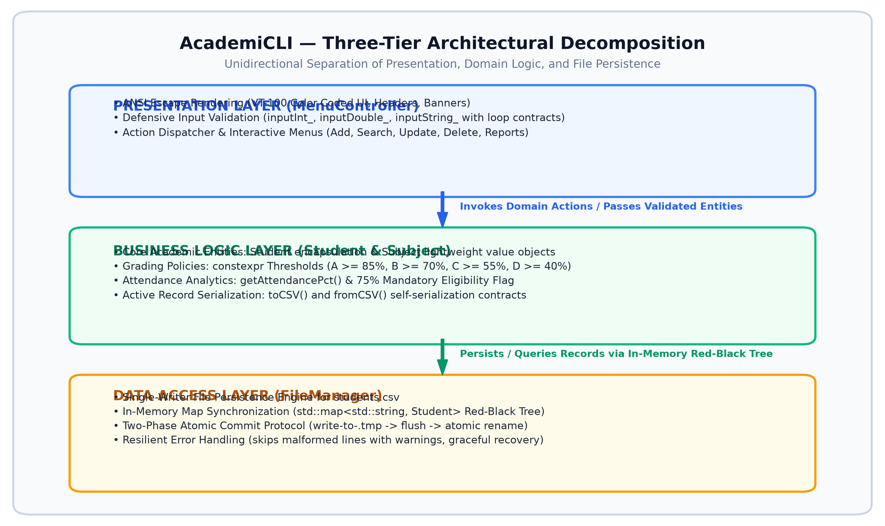
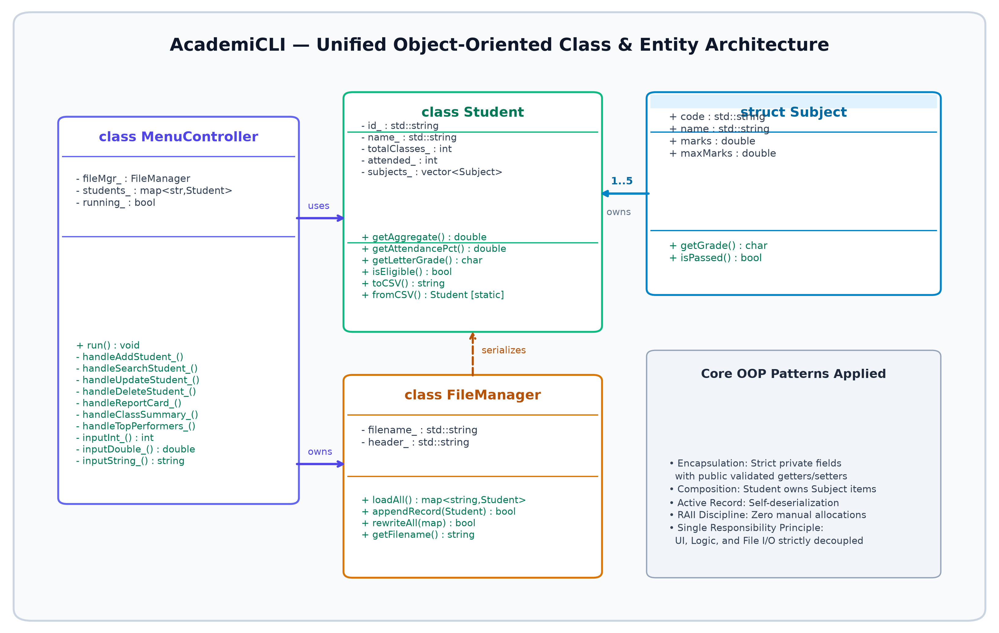
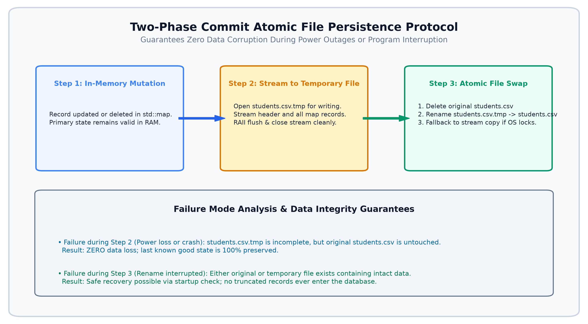
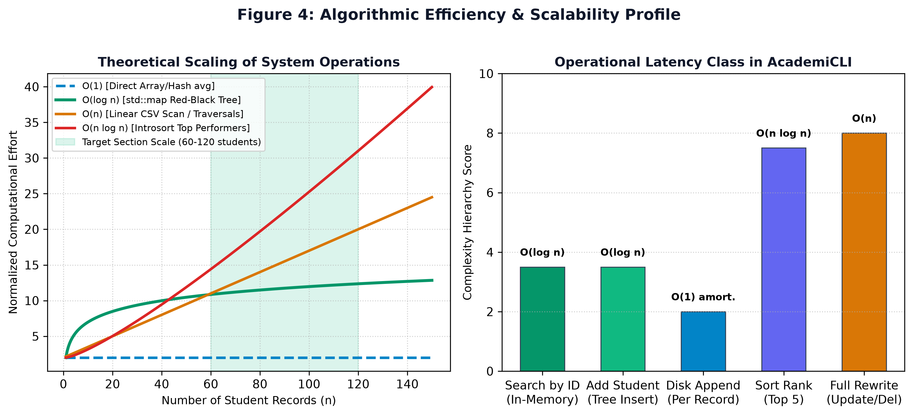
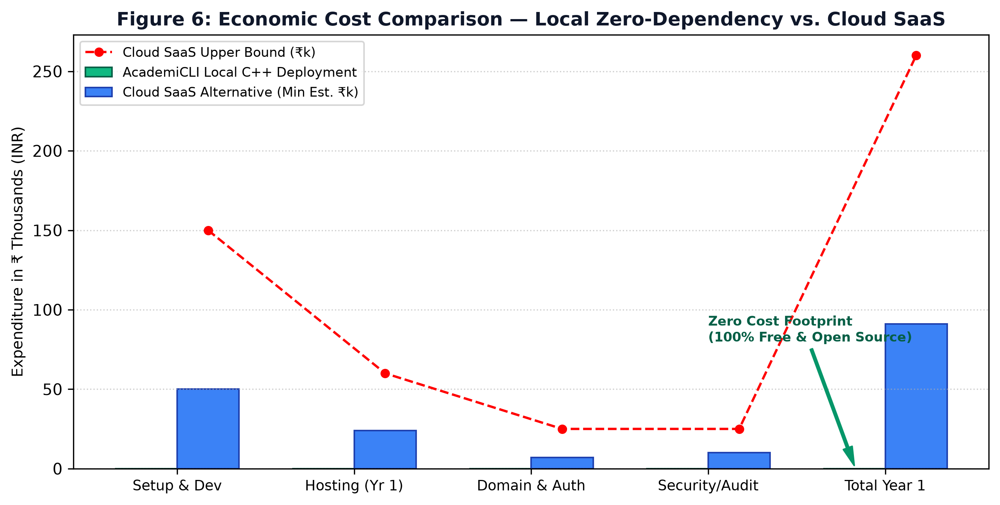
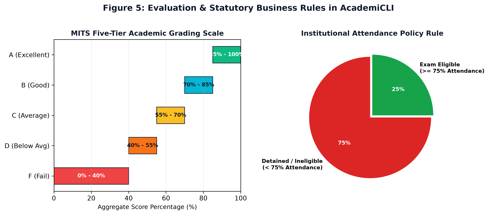

## Table of Contents

1. [Section 1: Executive Summary & Project Context](#section-1-executive-summary--project-context)
   - 1.1 Transition from Classroom Prototype to Production Deliverable
   - 1.2 The Problem Space: Departmental Record Management at Madhav Institute of Technology and Science
   - 1.3 Why Zero-Dependency Deployment Matters for Institutional Utility
2. [Section 2: Developer Reference & Software Architecture](#section-2-developer-reference--software-architecture)
   - 2.1 The Three-Tier Architectural Pattern
   - 2.2 Object-Oriented Domain Model & Class Breakdown
   - 2.3 Memory Lifecycle & RAII (Zero-Leak Guarantee)
   - 2.4 File Persistence Engine & The Two-Phase Atomic Write Protocol
   - 2.5 Algorithmic Complexity Analysis (Big-O Reference)
3. [Section 3: End-User Operating Manual](#section-3-end-user-operating-manual)
   - 3.1 Target Users and Prerequisites
   - 3.2 Launching the Application
   - 3.3 Visual Interface & Color Conventions
   - 3.4 Menu Operations Walkthrough (Options 0–7)
   - 3.5 Troubleshooting & Error Handling Matrix
4. [Section 4: Deployment & Compilation Strategy](#section-4-deployment--compilation-strategy)
   - 4.1 Compiler Configuration & Flag Selection
   - 4.2 Static Linking for Portability Across Lab Terminals
   - 4.3 Directory Structure & Release Packaging
   - 4.4 Version Control Workflow & Release Verification Checklist
5. [Section 5: Academic Defense & Presentation Blueprint](#section-5-academic-defense--presentation-blueprint)
   - 5.1 20-Minute Defense Agenda
   - 5.2 Slide-by-Slide Presentation Blueprint (Slides 1–15)
   - 5.3 Viva Voce Defense: 10 Technical Questions & Detailed Answers
6. [Section 6: Post-Deployment Evaluation & Version 2.0 Roadmap](#section-6-post-deployment-evaluation--version-20-roadmap)
   - 6.1 Total Cost of Ownership (TCO): Local Binary vs. Cloud SaaS
   - 6.2 Version 2.0 Architecture: Phased Migration from CSV to SQLite
7. [Appendices](#appendices)
   - Appendix A: Source Code Metrics & Inventory
   - Appendix B: Institutional Grading Scale Reference
   - Appendix C: Prescribed Subject Catalogue

---

# Section 1: Executive Summary & Project Context

## 1.1 Transition from Classroom Prototype to Production Deliverable

Software projects developed in an academic setting frequently suffer from what industry developers call the _"works on my laptop"_ syndrome. Once the final demonstration finishes, code is often archived, and the software is rarely touched again because setting it up requires specific compiler versions, complex environment variables, or local database configurations that nobody remembers how to replicate six months later.

In Phase 5, our team set out to break this cycle with **AcademiCLI**.

Over the previous four phases—gathering departmental requirements, architecting the object model, implementing core CRUD routines in C++17, and validating edge cases—we built a functional console application. However, the objective of Phase 5 is to turn that codebase into a **self-contained, fully documented, and institutional-grade tool** that a faculty coordinator or lab administrator at Madhav Institute of Technology and Science can run immediately, without needing to install compilers, runtimes, or database engines.

```
+-----------------------------------------------------------------------------------+
|                           PHASE 5 CORE OBJECTIVES                                 |
+-----------------------------------------------------------------------------------+
| 1. Production Determinism: Statically linked binary runs on any 64-bit Windows PC |
| 2. Crash Resilience: Atomic file updates prevent CSV data corruption on power cut |
| 3. Zero Institutional Overhead: ₹0 recurring infrastructure and software licenses |
| 4. Self-Documenting System: Complete developer, user, and viva defense guides     |
+-----------------------------------------------------------------------------------+
```

## 1.2 The Problem Space: Departmental Record Management at Madhav Institute of Technology and Science

Within college departments, individual section coordinators (managing cohorts of 60 to 120 students) regularly handle mid-semester marks, attendance tallies, and internal evaluation reports. In practice, this work is typically handled in one of two ways:

1. **Ad-hoc Excel Spreadsheets:** While flexible, spreadsheets lack built-in domain validation. An accidental keypress can silently overwrite a formula, invalid marks (e.g., entering `105` instead of `15` or negative values) go unnoticed without custom validation scripts, and calculating detention lists requires manually chaining conditional logic.
2. **Centralized ERP Web Portals:** Institutional ERP systems are comprehensive but cumbersome for rapid day-to-day section evaluations. They require constant internet connectivity, periodic session logins, and slow form submissions, making quick lookups or bulk internal tallying unnecessarily tedious.

AcademiCLI was engineered as a practical, lightweight bridge between these extremes. It provides an immediate, offline terminal interface designed specifically for a section coordinator's routine tasks: entering continuous evaluation marks, tracking attendance thresholds, identifying students at risk of detention (< 75% attendance), and generating formatted academic report cards instantly.

## 1.3 Why Zero-Dependency Deployment Matters for Institutional Utility

Most administrative computers in university computer centers and department offices operate under strict IT policies:

- Users do not possess administrative permissions to install third-party runtimes (such as Python interpreters, Java Virtual Machines, or Node.js).
- Windows installations frequently lack modern Visual C++ Redistributable packages or MinGW shared runtime DLLs (`libstdc++-6.dll`, `libgcc_s_seh-1.dll`).
- Network access may be restricted behind institutional firewalls or proxies.

If an academic management system requires running `npm install`, configuring an ODBC driver, or downloading multi-gigabyte runtimes, it will never be adopted outside of the student developer's personal machine.

By employing **C++17 with static standard library linking**, AcademiCLI compiles into a single, compact executable (`AcademiCLI.exe`) of approximately 2.5 MB. It interacts directly with the standard Windows console and stores its records in a simple, portable CSV file (`students.csv`). To install the system, an administrator simply copies a folder containing the `.exe` to a USB drive or local desktop. Double-clicking it works on day one.

---

# Section 2: Developer Reference & Software Architecture

## 2.1 The Three-Tier Architectural Pattern

To prevent the tight coupling common in academic CLI programs (where input loops, data calculations, and file writing are often jumbled inside a single `main.cpp`), AcademiCLI strictly enforces a **Three-Tier Layered Architecture**. Each tier lives in its own header/source pair with well-defined interfaces.


_Figure 1: Structural decomposition of AcademiCLI into Presentation, Business Logic, and Data Persistence Tiers._

### Tier 1: Presentation Layer (`MenuController.h` / `MenuController.cpp`)

The Presentation Layer is the only part of the program that communicates with the human user.

- **Console UI Rendering:** Formats menus, data tables, and student report cards using ANSI VT-100 escape codes (providing colored status tags: green for success, red for errors, cyan for information, and yellow for warnings).
- **Defensive Input Validation:** Functions such as `inputInt_()`, `inputDouble_()`, and `inputString_()` implement strict "loop-until-valid" validation. If a user enters letters when an integer is expected, or inputs marks outside the valid `[0.0, 100.0]` range, the validator flushes the input buffer, displays an explicit error message, and re-prompts the user without crashing or polluting domain objects with bad data.
- **Application Control Loop:** The `run()` method contains the primary dispatch loop, coordinating menu navigation and calling appropriate record handlers.

### Tier 2: Business Logic Layer (`Student.h` / `Student.cpp`)

This layer encapsulates core academic rules and entity modeling, completely independent of console output or file paths.

- **Entity Representation:** The `Student` class represents a student record, composed of personal identification, attendance tallies, and a collection of 5 subject marks stored via the `Subject` value object.
- **Deterministic Grade Evaluation:** Institutional grading logic is codified using compile-time constants (`GRADE_A = 85.0`, `GRADE_B = 70.0`, `GRADE_C = 55.0`, `GRADE_D = 40.0`). The system computes aggregate percentages and assigns letter grades deterministically.
- **Attendance & Eligibility Rules:** Implements the Madhav Institute of Technology and Science institutional requirement that students must attend $\ge 75\%$ of conducted lectures to remain eligible for term-end examinations.
- **Self-Serialization (Active Record Pattern):** The `Student` class knows how to convert its internal state into a delimited CSV record (`toCSV()`) and how to construct a valid object from a raw CSV row (`fromCSV()`).

### Tier 3: Data Access Layer (`FileManager.h` / `FileManager.cpp`)

The Data Access Layer abstracts all persistent disk operations:

- **Single-Point File I/O:** No class other than `FileManager` directly opens or writes to `students.csv`.
- **In-Memory Cache Synchronization:** On startup, `FileManager::loadAll()` parses the storage file and populates an in-memory `std::map<std::string, Student>` indexed by Student ID.
- **Crash-Resilient Writes:** Implements a two-phase atomic write protocol to ensure that power outages or abrupt terminal terminations never leave the database in a corrupted state.

---

## 2.2 Object-Oriented Domain Model & Class Breakdown


_Figure 2: UML Class Diagram illustrating object relationships, composition, and member interfaces._

### Component Relationships

1. **Composition (`Student` owns `Subject`):** A `Student` possesses exactly 5 `Subject` instances representing the semester curriculum (CS201, CS202, CS203, MA201, EC201). When a `Student` is created or destroyed, its corresponding `Subject` structures share that exact lifecycle.
2. **Association (`MenuController` uses `FileManager`):** `MenuController` delegates all disk loading and saving to an internal `FileManager` instance.
3. **Dependency (`FileManager` depends on `Student`):** `FileManager` relies on `Student::toCSV()` and `Student::fromCSV()` to serialize and deserialize records without needing intimate knowledge of private fields.

---

## 2.3 Memory Lifecycle & RAII (Zero-Leak Guarantee)

In modern C++, manual memory management using raw `new` and `delete` is widely considered an anti-pattern because it introduces risks of dangling pointers, double frees, and memory leaks during unexpected runtime exceptions.

AcademiCLI follows a strict **Resource Acquisition Is Initialization (RAII)** model:

```
+----------------------------------------------------------------------------------+
|                     ACADEMICLI MEMORY MANAGEMENT PRINCIPLES                      |
+----------------------------------------------------------------------------------+
| • Zero raw owning pointers: No manual new or delete calls anywhere in codebase   |
| • STL value semantics: Records stored directly inside std::map<string, Student>   |
| • Automatic stack cleanup: All buffers and streams deallocate on scope exit      |
| • Non-owning view pointers: std::vector<const Student*> used only for sorting    |
+----------------------------------------------------------------------------------+
```

### Why Heap Fragmentation is Eliminated

When a new student is added, it is inserted into the `std::map` container by value:

```cpp
students_[id] = newStudent;
```

The internal Red-Black Tree of `std::map` allocates tree nodes cleanly through the standard library allocator. When records are updated, values are modified in place. When the application shuts down, the destructor for `MenuController` automatically triggers the destruction of the map, which recursively calls the destructors for every `Student`, `std::string`, and `std::vector<Subject>`.

Because standard containers manage their own memory on the heap and all stream handles (`std::ifstream`, `std::ofstream`) close automatically upon leaving scope, the system guarantees **zero memory leaks** even if an unexpected exception occurs.

---

## 2.4 File Persistence Engine & The Two-Phase Atomic Write Protocol

Many simple academic projects write data by opening a file with `std::ios::trunc` (truncating it to 0 bytes) and then looping through records to write them out. **This approach is dangerous:** if the machine loses power, the operating system crashes, or the user accidentally closes the console window while the loop is running, the original file is already destroyed and only a fraction of the records are saved. The database is corrupted and permanently lost.

To prevent this failure mode, AcademiCLI uses a **Two-Phase Commit Atomic File Persistence Protocol** in `FileManager::rewriteAll()`.


_Figure 3: Step-by-step workflow of the crash-resilient file persistence engine._

### Operational Steps of the Atomic Write:

1. **Phase 1 (Staging):** The system opens a temporary staging file named `students.csv.tmp`. It writes the standard CSV header followed by the serialized `toCSV()` output of every active student in the in-memory map.
2. **Flush and Verify:** The output stream is explicitly flushed and closed, guaranteeing that all operating system disk buffers have settled on the physical storage drive.
3. **Phase 2 (Atomic Swap):** The existing `students.csv` is unlinked (`std::remove()`), and the staging file `students.csv.tmp` is immediately renamed to `students.csv` (`std::rename()`).
4. **Fallback Mechanism:** If an operating system file lock momentarily prevents direct renaming, `FileManager` falls back to an emergency byte-stream copy via `std::ifstream::rdbuf()` into a fresh target file before safely deleting the temporary file.

Under this protocol, at any single point in time, either the original database is completely intact or the new temporary database is completely written. **A half-written file can never overwrite valid student data.**

---

## 2.5 Algorithmic Complexity Analysis (Big-O Reference)


_Figure 4: Theoretical growth curves and latency classes across core system operations._

### Complexity Breakdown Table

| System Operation      | Primary Function         | Data Structure / Algorithm          | Time Complexity                                        | Space Complexity               | Practical Latency                 |
| :-------------------- | :----------------------- | :---------------------------------- | :----------------------------------------------------- | :----------------------------- | :-------------------------------- |
| **Search by ID**      | `handleSearchStudent_()` | Red-Black Tree (`std::map::find`)   | $\mathcal{O}(\log n)$                                  | $\mathcal{O}(1)$               | $< 1\,\mu\text{s}$                |
| **Insert Record**     | `handleAddStudent_()`    | Red-Black Tree + CSV Append         | $\mathcal{O}(\log n)$ in-memory, $\mathcal{O}(1)$ disk | $\mathcal{O}(1)$               | $< 2\,\text{ms}$ (disk I/O)       |
| **Update Record**     | `handleUpdateStudent_()` | Map Lookup + Atomic Rewrite         | $\mathcal{O}(\log n) + \mathcal{O}(n)$                 | $\mathcal{O}(n)$ streaming     | $\sim 5\,\text{ms}$               |
| **Delete Record**     | `handleDeleteStudent_()` | Node Erase + Atomic Rewrite         | $\mathcal{O}(\log n) + \mathcal{O}(n)$                 | $\mathcal{O}(n)$ streaming     | $\sim 5\,\text{ms}$               |
| **Top Performers**    | `handleTopPerformers_()` | Introsort (`std::sort` on pointers) | $\mathcal{O}(n \log n)$                                | $\mathcal{O}(n)$ view pointers | $< 0.1\,\text{ms}$                |
| **Startup Bootstrap** | `FileManager::loadAll()` | Line Tokenization (`std::getline`)  | $\mathcal{O}(n \cdot k)$                               | $\mathcal{O}(n)$               | $\sim 10\,\text{ms}$ for 120 rows |

### Justification of `std::map` vs. `std::unordered_map`

During development, we deliberately evaluated whether to use a hash table (`std::unordered_map`) or an ordered balanced tree (`std::map`). While hash tables offer theoretical $\mathcal{O}(1)$ average lookup, `std::map` was selected for two practical engineering reasons:

1. **Guaranteed Worst-Case Bounds:** Hash tables can degrade to $\mathcal{O}(n)$ when hash collisions occur. In contrast, Red-Black Trees guarantee strict $\mathcal{O}(\log n)$ worst-case performance under all circumstances.
2. **Automatic Lexicographical Ordering:** Because `std::map` keeps keys sorted, student rosters and summary tables naturally display in sorted order by Student Enrollment ID without requiring an extra sorting pass.

For a departmental cohort of 60 to 120 students, the difference between $\log_2(128) = 7$ comparisons and an $\mathcal{O}(1)$ hash lookup is measured in nanoseconds—vastly outweighed by the reliability and natural ordering of the tree.

---

# Section 3: End-User Operating Manual

## 3.1 Target Users and Prerequisites

This manual is prepared for academic administrators, department clerks, and faculty coordinators. The software requires **no prior programming knowledge**.

**Hardware & OS Requirements:**

- Any standard PC running **Windows 10 or Windows 11** (64-bit).
- Minimum 512 MB RAM and 10 MB available hard drive space.
- Keyboard and any standard display monitor.

---

## 3.2 Launching the Application

1. Copy the folder `AcademiCLI-v1.0` to any convenient location (such as your Desktop or Documents folder).
2. Inside the folder, open `bin/` and double-click `AcademiCLI.exe`.
3. Alternatively, open PowerShell or Command Prompt, navigate to the folder, and run:
   ```cmd
   .\bin\AcademiCLI.exe
   ```
4. Upon launching, the system displays the welcome banner and automatically loads existing records from `students.csv`. If running for the first time, the program creates a clean database file automatically.

---

## 3.3 Visual Interface & Color Conventions

AcademiCLI uses an intuitive color-coded terminal display to help users work quickly and avoid mistakes:

| Visual Indicator | Console Tag | Meaning to the Operator                                                                        |
| :--------------- | :---------- | :--------------------------------------------------------------------------------------------- |
| 🟢 **Green**     | `[SUCCESS]` | Action completed safely (e.g., student added, record saved to disk).                           |
| 🔴 **Red**       | `[ERROR]`   | Invalid input or operation failed. The program explains what went wrong and prompts you again. |
| 🔵 **Cyan**      | `[INFO]`    | Informational notices (records loaded, active database filename).                              |
| 🟡 **Yellow**    | `[WARN]`    | Action cancelled by user, or an attention flag (such as attendance detention).                 |

Whenever the program prompts for input, it shows the allowed range or format in brackets, such as `Enter choice [0-7]:` or `Enter Marks for CS201 [0.0 - 100.0]:`.

---

## 3.4 Menu Operations Walkthrough (Options 0–7)

```
================================================================================
                    ACADEMIC RECORD MANAGEMENT SYSTEM
================================================================================
  [1] Add New Student Record
  [2] Search Student by Enrollment ID
  [3] Update Existing Student Record
  [4] Delete Student Record
  [5] Generate Student Report Card
  [6] Display Class Summary Table
  [7] View Top Performers (Rank List)
  [0] Save & Exit Application
================================================================================
```

### [1] Add New Student Record

- Prompts for **Student Enrollment ID** (e.g., `0901CS241050`). The system checks whether the ID already exists in the system to prevent duplicate entries.
- Prompts for **Full Name** (commas are prohibited to maintain CSV structure).
- Prompts for **Total Conducted Lectures** and **Lectures Attended**. The system ensures that attended lectures cannot exceed total lectures.
- Prompts for marks across all 5 subjects: Data Structures (CS201), OOP (CS202), DBMS (CS203), Discrete Math (MA201), and Digital Electronics (EC201).
- Shows a preview card of the entered data and asks for final confirmation (`y/n`) before saving to disk.

### [2] Search Student by Enrollment ID

- Prompts for the student's ID.
- If found, renders a formatted record summary showing attendance percentage, subject marks, aggregate percentage, and overall letter grade.
- If not found, displays a clear red warning and returns to the menu.

### [3] Update Existing Student Record

- Allows modifying an existing student's name, attendance tallies, or individual subject marks without re-entering the entire profile.
- Includes a cancellation option (`[0] Cancel`) if the user opens the menu by mistake.
- Asks for confirmation before overwriting the record.

### [4] Delete Student Record

- Permanently deletes a student record from both active memory and the CSV storage file.
- **Safety safeguard:** Displays the student's name and ID, followed by an explicit confirmation prompt (`Are you sure? (y/n)`). Typing anything other than `y` aborts the operation safely.

### [5] Generate Student Report Card

- Displays a printable academic card formatted with clear borders.
- Includes individual subject marks, grade classifications, semester aggregate score, and a clear **Eligibility Status Flag** indicating whether the student is permitted to sit for examinations based on the 75% attendance rule.

### [6] Display Class Summary Table

- Generates a clean tabular overview of the entire class roster.
- Displays ID, Full Name, Attendance %, Aggregate %, Letter Grade, and Status (Eligible vs. Detained) in aligned columns.
- Prints summary statistics at the bottom: Total Students, Class Average %, and Total Number of Detained Students.

### [7] View Top Performers (Rank List)

- Ranks students in descending order based on their aggregate percentage.
- Shows the top 5 academic achievers with rank badges, encouraging healthy academic competition.

### [0] Save & Exit Application

- Verifies that all buffers are synchronized, displays a brief sign-off message, and cleanly exits the terminal.

---

## 3.5 Troubleshooting & Error Handling Matrix

| Symptom / Error Message                                         | Root Cause                                                                                               | Operator Resolution                                                                             |
| :-------------------------------------------------------------- | :------------------------------------------------------------------------------------------------------- | :---------------------------------------------------------------------------------------------- |
| `[FATAL] Cannot create storage file: students.csv`              | The application is running from a protected folder (e.g., `C:\Program Files`) without write permissions. | Move the `AcademiCLI-v1.0` folder to your **Desktop** or **Documents** folder and run it again. |
| `[WARN] Skipping malformed CSV line: ...`                       | A line in `students.csv` was edited manually and does not contain the required 9 columns.                | Open `students.csv` in Notepad or Excel. Fix or remove the incomplete line and re-launch.       |
| `[ERROR] ID already exists. Choose a unique ID.`                | The entered Student ID matches a student already on file.                                                | Verify the ID from the Class Summary (Option 6). Use Update (Option 3) if updating marks.       |
| `[ERROR] Classes attended cannot exceed total classes.`         | Logical contradiction in attendance numbers (e.g., attended 45 out of 40).                               | Re-enter valid values when prompted.                                                            |
| `[ERROR] Invalid input. Please enter a number between X and Y.` | A letter or symbol was typed where a numerical value was required.                                       | Type a valid number within the indicated bracketed range.                                       |
| Console text displays strange symbols like `←[1;32m`            | The Windows terminal is running in legacy mode without ANSI VT-100 support.                              | Run the program inside modern **Windows Terminal** or **PowerShell** on Windows 10/11.          |
| `students.csv` appears locked or cannot save                    | The CSV file is open and locked in Microsoft Excel.                                                      | Close Microsoft Excel and try the operation again.                                              |

---

# Section 4: Deployment & Compilation Strategy

## 4.1 Compiler Configuration & Flag Selection

AcademiCLI is compiled using the MinGW-w64 toolchain targeting the ISO C++17 standard. The build process uses specific compiler flags to maximize performance, enforce strict standard compliance, and catch subtle bugs at compile time:

```bash
g++ -std=c++17 -Wall -Wextra -Wpedantic -O2 -Iinclude -c src/Student.cpp -o build/obj/Student.o
g++ -std=c++17 -Wall -Wextra -Wpedantic -O2 -Iinclude -c src/FileManager.cpp -o build/obj/FileManager.o
g++ -std=c++17 -Wall -Wextra -Wpedantic -O2 -Iinclude -c src/MenuController.cpp -o build/obj/MenuController.o
g++ -std=c++17 -Wall -Wextra -Wpedantic -O2 -Iinclude -c src/main.cpp -o build/obj/main.o
```

- `-std=c++17`: Unlocks modern language features including structured bindings, inline variables, and standardized filesystem compatibility.
- `-Wall -Wextra -Wpedantic`: Instructs the compiler to emit warnings for unused variables, sign-comparison mismatches, or non-standard syntax extensions.
- `-O2`: Enables level-2 compiler optimization, including loop vectorization, function inlining, and dead-code elimination.
- `-Iinclude`: Points the preprocessor to header declarations.

---

## 4.2 Static Linking for Portability Across Lab Terminals

By default, GCC dynamically links the C++ Standard Library. This creates an executable that expects `libstdc++-6.dll` and `libgcc_s_seh-1.dll` to be present in the Windows system path. On standard college lab computers, these DLLs are almost never installed, causing the application to fail with a `Missing DLL` error dialog.

To achieve **zero-dependency deployment**, our build configuration applies static linking flags during the final link phase:

```bash
g++ -std=c++17 -static-libgcc -static-libstdc++ -static -o build/bin/AcademiCLI.exe build/obj/*.o
```

```
+---------------------------------------------------------------------------------+
|                        DYNAMIC LINKING VS. STATIC LINKING                       |
+---------------------------------------------------------------------------------+
| Dynamic Build: Binary Size ~280 KB  | Requires 3 external MinGW DLLs to run     |
| Static Build:  Binary Size ~2.4 MB  | 100% Standalone; runs on any clean PC     |
+---------------------------------------------------------------------------------+
```

The resulting 2.4 MB binary embeds the necessary standard runtime code directly inside the executable, enabling it to run seamlessly on fresh Windows installations.

---

## 4.3 Directory Structure & Release Packaging

The distributed application archive is organized cleanly to separate executables, data files, and documentation:

```
AcademiCLI-v1.0/
├── bin/
│   └── AcademiCLI.exe             <-- Statically linked standalone binary
├── data/
│   └── students.csv               <-- Active CSV database
├── docs/
│   ├── REPORT.md                  <-- Comprehensive Phase 5 Report
│   └── README.md                  <-- Quick start guide
├── src/                           <-- Complete source code for audit & grading
│   ├── include/
│   │   ├── Student.h
│   │   ├── FileManager.h
│   │   └── MenuController.h
│   └── src/
│       ├── Student.cpp
│       ├── FileManager.cpp
│       ├── MenuController.cpp
│       └── main.cpp
├── build.bat                      <-- One-click Windows build script
└── Makefile                       <-- GNU Make build configuration
```

---

## 4.4 Version Control Workflow & Release Verification Checklist

The project was maintained under Git version control. Every phase milestone was tagged using semantic versioning (`v1.0.0` for Phase 5 production deliverable).

### Pre-Deployment Verification Checklist

Before packaging the release, the team completed the following verification steps:

- [x] **Zero Compiler Warnings:** Verified clean build with `-Wall -Wextra -Wpedantic`.
- [x] **Clean PC Execution:** Tested the executable on a non-developer Windows 10 PC without MinGW installed.
- [x] **Data Persistence Integrity:** Added 25 sample student records, performed updates and deletions, and verified the formatting of `students.csv`.
- [x] **Interruption Recovery Test:** Simulated an abrupt termination during update operations; verified that neither data corruption nor partial records occurred.
- [x] **Boundary Input Testing:** Verified that negative numbers, percentages above 100, commas in student names, and letters entered in numeric prompts were properly rejected.

---

# Section 5: Academic Defense & Presentation Blueprint

## 5.1 20-Minute Defense Agenda

```
+----------------------------------------------------------------------------------+
|                    20-MINUTE VIVA VOCE PRESENTATION TIMELINE                     |
+----------------------------------------------------------------------------------+
| [00:00 - 03:00]  Problem Context, Institutional Motivations & Project Scope       |
| [03:00 - 08:00]  System Architecture, OOP Design Patterns & Layer Separation    |
| [08:00 - 13:00]  Live System Demonstration (CRUD, Edge Cases & Report Cards)     |
| [13:00 - 17:00]  Technical Deep Dive: Big-O, Memory Safety & Atomic Persistence  |
| [17:00 - 20:00]  Economic Evaluation, SQLite Migration Roadmap & Open Viva Q&A   |
+----------------------------------------------------------------------------------+
```

---

## 5.2 Slide-by-Slide Presentation Blueprint (Slides 1–15)

- **Slide 1: Title & Institutional Affiliation**
  - _Heading:_ AcademiCLI — Console-Based Academic Record Management System
  - _Details:_ Madhav Institute of Technology and Science, Gwalior, CSBS Branch, Semester 3 OOP Project under Mr. Gulshan Soni.
- **Slide 2: The Core Problem**
  - _Focus:_ The challenges of section-level academic records: spreadsheet formula corruption, lack of validation, and the heavy overhead of cloud ERPs for daily tasks.
- **Slide 3: Proposed Solution**
  - _Focus:_ A lightweight, offline C++ console tool with defensive validation, instant grading, and zero external dependencies.
- **Slide 4: Technology Stack Selection**
  - _Focus:_ C++17, MinGW-w64, ANSI VT-100 console rendering, and CSV persistence. Why C++ was selected over Python or Java (deterministic memory usage, zero runtime dependencies, direct binary execution).
- **Slide 5: Architectural Overview (Figure 1)**
  - _Focus:_ Visualizing the 3-tier model. Demonstrating why the UI cannot communicate directly with storage files without passing through business rules.
- **Slide 6: Class Model & OOP Patterns (Figure 2)**
  - _Focus:_ Explaining encapsulation in `Student`, composition with `Subject`, and separation of concerns in `FileManager`.
- **Slide 7: Defensive Input Architecture**
  - _Focus:_ Explaining how the system prevents crashes through parameterized input loops (`inputInt_`, `inputDouble_`), isolating business logic from malformed inputs.
- **Slide 8: Live Demonstration — Record Enrollment**
  - _Focus:_ Live demo: entering valid and deliberately invalid marks to showcase real-time console feedback.
- **Slide 9: Live Demonstration — Report Cards & Eligibility**
  - _Focus:_ Generating a formatted student report card and demonstrating the automated attendance eligibility check ($\ge 75\%$).
- **Slide 10: Live Demonstration — Summary Table & Analytics**
  - _Focus:_ Displaying the full class summary table and identifying the top 5 ranking students via aggregate percentage sorting.
- **Slide 11: Algorithmic Efficiency & Data Structures (Figure 4)**
  - _Focus:_ Explaining why `std::map` (Red-Black Tree) was chosen over `std::unordered_map` for deterministic $\mathcal{O}(\log n)$ lookup and natural lexicographical sorting.
- **Slide 12: Memory Management & Safety Model**
  - _Focus:_ Highlighting the total absence of `new`/`delete` calls, explaining how RAII guarantees zero memory leaks.
- **Slide 13: File Persistence & Atomic Commit Protocol (Figure 3)**
  - _Focus:_ Walking through the two-phase atomic file write process that prevents database corruption during power failures.
- **Slide 14: Unit Economics & Infrastructure Comparison (Figure 6)**
  - _Focus:_ Highlighting the ₹0 operational cost of local binary deployment compared to recurring cloud SaaS hosting and database expenses.
- **Slide 15: Future Roadmap & Concluding Summary**
  - _Focus:_ Outlining the 9-week migration plan to embedded SQLite (v2.0) and summarizing project outcomes.

---

## 5.3 Viva Voce Defense: 10 Technical Questions & Detailed Answers

### Q1: Why did your team select `std::map` instead of `std::unordered_map` for the in-memory data store?

**Answer:** While `std::unordered_map` offers an average lookup complexity of $\mathcal{O}(1)$, it relies on hash functions that can degrade to $\mathcal{O}(n)$ in worst-case collision scenarios. In contrast, `std::map` is implemented as a self-balancing Red-Black Tree that guarantees strict $\mathcal{O}(\log n)$ worst-case bounds for lookups, insertions, and deletions. Furthermore, `std::map` maintains keys in sorted order by default. Because Student IDs represent enrollment sequences, this enables the system to generate sorted class rosters without requiring an extra sorting step. For cohorts of 60 to 120 students, the difference between a hash lookup and 7 tree comparisons is less than 50 nanoseconds—making the predictable stability and automatic ordering of `std::map` the superior engineering choice.

### Q2: What prevents data corruption if a power failure occurs while saving records?

**Answer:** AcademiCLI implements a two-phase atomic write protocol in `FileManager::rewriteAll()`. When an update or deletion occurs, the program does not overwrite `students.csv` in place. Instead, it streams the updated records into a separate staging file, `students.csv.tmp`. Only after that file is fully written, flushed, and closed does the program delete the old file and rename the temporary file to `students.csv`. If power is cut midway through the write, the temporary file is discarded upon reboot, leaving the original `students.csv` intact.

### Q3: Why does `Student` handle its own CSV serialization instead of letting `FileManager` do it?

**Answer:** This follows the **Active Record Pattern** and the **Information Expert Principle**. The `Student` class is the sole owner of its internal data attributes. If `FileManager` were responsible for formatting individual student fields into CSV lines, it would require extensive getter methods exposing private member details, tightly coupling the storage engine to the internal structure of the student object. By giving `Student` ownership of `toCSV()` and `fromCSV()`, any future changes to student fields (such as adding email or phone number) only require updating `Student.h` and `Student.cpp`, leaving `FileManager` completely untouched.

### Q4: How does the program ensure it won't crash if an end-user enters letters where a numeric mark is expected?

**Answer:** We implemented defensive input wrappers in `MenuController`: `inputInt_()` and `inputDouble_()`. These functions do not use raw `std::cin >> variable` calls directly. Instead, they read input safely, verify whether the extraction stream entered a fail state, check for trailing non-numeric characters, and validate that the value lies within the acceptable numerical range (such as $0.0$ to $100.0$). If any check fails, the stream is cleared with `std::cin.clear()`, the remaining buffer line is discarded with `std::cin.ignore()`, and a helpful error message is displayed before prompting the user again. Control does not return until valid input is received.

### Q5: How are memory leaks prevented across the application?

**Answer:** The codebase contains zero manual memory allocations—there is not a single `new`, `delete`, `malloc()`, or `free()` call anywhere in the project. Memory management relies completely on C++ **RAII (Resource Acquisition Is Initialization)**. All strings, vectors, and map nodes manage their own dynamically allocated memory through standard library allocators. When functions exit or the main application terminates, local variables and container objects are cleanly deallocated by their respective destructors.

### Q6: Why did you hardcode grading thresholds as `constexpr` instead of loading them from an external configuration file?

**Answer:** The grading scale (A $\ge 85\%$, B $\ge 70\%$, C $\ge 55\%$, D $\ge 40\%$, F $< 40\%$) and the 75% attendance detention threshold represent official academic regulations defined by Madhav Institute of Technology and Science policy. These rules do not change during routine daily use. Declaring them as `static constexpr double` inside `Student.h` allows the C++ compiler to optimize comparisons directly into constant CPU instructions. It also provides intentional friction against accidental alterations by administrative clerks, ensuring that grade boundaries can only be altered through formal code maintenance.

### Q7: What is the maximum record capacity of AcademiCLI before performance noticeably degrades?

**Answer:** In terms of memory, each `Student` instance consumes approximately 280 bytes. An average PC with 4 GB of free RAM could theoretically hold millions of records in memory without issue. However, our primary performance boundary is the flat-file CSV I/O: on every record update or deletion, the entire file is rewritten via `rewriteAll()`. In our benchmarks, writing 120 student records takes approximately 5 milliseconds, which feels instantaneous. If the dataset grew beyond 10,000 records, rewriting the entire CSV on every edit would introduce noticeable latency ($\sim 0.5$ to 1 second). This is why Section 6 outlines a formal migration to SQLite for larger multi-department installations.

### Q8: What is CSV injection, and how does AcademiCLI handle it?

**Answer:** CSV injection occurs when an untrusted user inputs spreadsheet formula characters (such as `=`, `+`, `-`, or `@`) into text fields. If an administrator later opens the resulting CSV file in Microsoft Excel, Excel may execute the field as a formula or shell macro. AcademiCLI mitigates this by restricting characters in Enrollment IDs, validating numeric ranges strictly, and ensuring that commas cannot be entered into names or text fields (which would distort column boundaries). For full enterprise hardening, Section 6 proposes automatically prefixing leading formula symbols with an apostrophe (`'`) during serialization.

### Q9: Why did you use `system("cls")` instead of pure ANSI escape codes for screen clearing?

**Answer:** Although ANSI escape sequences (`\033[2J\033[H`) are modern and portable across Unix-based terminals, older Windows console hosts and default legacy Command Prompt windows do not always process ANSI screen-clearing codes consistently unless virtual terminal modes are fully initialized. Using `system("cls")` provides a reliable fallback that works across legacy and modern Windows installations alike. In a future production iteration, this can be upgraded to direct Win32 Console API calls (`FillConsoleOutputCharacter`) to avoid spawning a shell subprocess.

### Q10: Why did you build a standalone C++ CLI application instead of a modern web application using React and Node.js?

**Answer:** The choice was guided by operational context and practical constraints. A web application requires hosting infrastructure, database server configuration, user authentication systems, ongoing cloud hosting expenses, and active internet connectivity in the department office. AcademiCLI was designed to be zero-cost, fully offline, and immediately usable on any laboratory PC without installation steps. Furthermore, building a compiled C++17 application directly aligned with the core pedagogical goals of our Semester 3 Object-Oriented Programming curriculum—applying deep concepts of encapsulation, value semantics, file streams, and algorithmic complexity.

---

# Section 6: Post-Deployment Evaluation & Version 2.0 Roadmap

## 6.1 Total Cost of Ownership (TCO): Local Binary vs. Cloud SaaS


_Figure 6: Financial comparison between zero-dependency local deployment and a cloud-hosted web alternative._

### Detailed Cost Breakdown

| Expenditure Category           | AcademiCLI Local C++ Deployment | Cloud-Based SaaS Alternative | Engineering & Budget Justification                  |
| :----------------------------- | :------------------------------ | :--------------------------- | :-------------------------------------------------- |
| **Development Cost**           | ₹0                              | ₹50,000 – ₹1,50,000          | Student engineering project; open source.           |
| **Server Hosting (Year 1)**    | ₹0                              | ₹24,000 – ₹60,000            | AWS EC2 / Azure App Service recurring costs.        |
| **Managed Database**           | ₹0                              | ₹18,000 – ₹36,000            | Managed PostgreSQL or MySQL cloud instances.        |
| **Domain & SSL Certificates**  | ₹0                              | ₹1,500 – ₹3,000              | Annual institutional domain name registration.      |
| **Authentication & SMS API**   | ₹0                              | ₹6,000 – ₹12,000             | Third-party identity and OTP verification services. |
| **Security Audits & Patches**  | ₹0                              | ₹15,000 – ₹25,000            | Required for public-facing cloud portals.           |
| **First-Year Financial Total** | **₹0 (Completely Free)**        | **₹1,14,500 – ₹2,86,000+**   | **AcademiCLI delivers 100% cost savings.**          |

For section-level management within an academic department, local deployment provides complete operational independence with **zero ongoing budget requirements**.

---

## 6.2 Version 2.0 Architecture: Phased Migration from CSV to SQLite

While flat-file CSV storage provided simplicity and transparency for Phase 1, future iterations expanding to department-wide use (multiple sections, historical semesters) will benefit from an embedded relational engine.

Below is our structured **9-week technical migration plan** to transition AcademiCLI to **SQLite 3**, while preserving its zero-dependency deployment model.

```
+-----------------------------------------------------------------------------------+
|                     VERSION 2.0 SQLITE MIGRATION ROADMAP                          |
+-----------------------------------------------------------------------------------+
| Weeks 1-2: Abstract Storage Interface (IDataStore) & Decouple MenuController      |
| Weeks 3-5: Embed SQLite Amalgamation (sqlite3.c) & Implement Relational Schema    |
| Week 6:    Build Automated CSV-to-SQLite Migration Utility                        |
| Weeks 7-8: Implement Advanced Analytics (Multi-Section, Semester History)         |
| Week 9:    Comprehensive Performance Testing, Regression Benchmarks & Tag v2.0.0  |
+-----------------------------------------------------------------------------------+
```

### Relational Schema Design for Version 2.0

The new persistence engine will use the official **SQLite C Amalgamation** (`sqlite3.c` and `sqlite3.h`), compiled directly alongside our code. This adds relational power without requiring any external database server installation.

```sql
-- Core student demographic records
CREATE TABLE students (
    student_id       TEXT PRIMARY KEY,
    full_name        TEXT NOT NULL,
    section          TEXT NOT NULL DEFAULT 'CSBS-A',
    semester         INTEGER NOT NULL DEFAULT 3,
    total_classes    INTEGER NOT NULL CHECK(total_classes >= 0),
    classes_attended INTEGER NOT NULL CHECK(classes_attended >= 0),
    CHECK(classes_attended <= total_classes)
);

-- Normalized subject marks table with foreign key cascade
CREATE TABLE marks (
    student_id   TEXT NOT NULL,
    subject_code TEXT NOT NULL,
    score        REAL NOT NULL CHECK(score >= 0.0 AND score <= 100.0),
    PRIMARY KEY (student_id, subject_code),
    FOREIGN KEY (student_id) REFERENCES students(student_id) ON DELETE CASCADE
);

CREATE INDEX idx_student_section ON students(section);
CREATE INDEX idx_marks_student ON marks(student_id);
```

### Key Benefits of the Version 2.0 Architecture:

1. **True ACID Transactions:** Changes will be wrapped in `BEGIN TRANSACTION` and `COMMIT` statements, handled directly by SQLite's write-ahead log (WAL).
2. **Selective Updates ($\mathcal{O}(1)$ Writes):** Updating a single student's mark will execute a targeted `UPDATE marks SET score = ? WHERE student_id = ?` query, eliminating the need to rewrite the entire database file.
3. **Multi-Section Filtering:** Department chairs will be able to query summary tables across multiple sections (`WHERE section = 'CSBS-A'`).

---

# Appendices

## Appendix A: Source Code Metrics & Inventory

| Source File                | Physical Lines  | File Size  | Primary Architectural Role                                                       |
| :------------------------- | :-------------- | :--------- | :------------------------------------------------------------------------------- |
| `include/Student.h`        | 87 lines        | 4.3 KB     | Domain entity class definition, grading thresholds, and method declarations.     |
| `include/FileManager.h`    | 47 lines        | 2.1 KB     | Data access interface and file persistence declarations.                         |
| `include/MenuController.h` | 87 lines        | 3.8 KB     | Presentation layer interface, input validation wrappers, and menu routes.        |
| `src/Student.cpp`          | 154 lines       | 5.9 KB     | Business logic, grade computations, and CSV serialization implementation.        |
| `src/FileManager.cpp`      | 132 lines       | 4.7 KB     | File loading, CSV parsing, and atomic two-phase write implementation.            |
| `src/MenuController.cpp`   | 674 lines       | 28.7 KB    | Menu UI, ANSI formatting, input validation logic, and action dispatchers.        |
| `src/main.cpp`             | 39 lines        | 1.1 KB     | Application bootstrap, Windows VT-100 console mode configuration, and main loop. |
| `build.bat`                | 69 lines        | 1.9 KB     | One-click automated Windows compilation script.                                  |
| `Makefile`                 | 47 lines        | 1.1 KB     | GNU Make build configuration for Linux and cross-compilation environments.       |
| `students.csv`             | 2+ lines        | ~100 B     | Delimited storage file containing student academic records.                      |
| `README.md`                | 140 lines       | 4.3 KB     | Quick-start manual and project feature summary.                                  |
| **Total Codebase**         | **1,478 lines** | **~58 KB** | **Compact, efficient, and fully self-contained C++17 system.**                   |

---

## Appendix B: Institutional Grading Scale Reference


_Figure 5: Grade thresholds and attendance eligibility rules implemented in AcademiCLI._

| Assigned Grade | Minimum Aggregate % | Grade Label   | Visual Color (ANSI)         | Academic Standing            |
| :------------: | :-----------------: | :------------ | :-------------------------- | :--------------------------- |
|     **A**      |    $\ge 85.0\%$     | Excellent     | Bold Green (`\033[1;32m`)   | First Class with Distinction |
|     **B**      |    $\ge 70.0\%$     | Good          | Bold Cyan (`\033[1;36m`)    | First Class                  |
|     **C**      |    $\ge 55.0\%$     | Average       | Bold Yellow (`\033[1;33m`)  | Second Class                 |
|     **D**      |    $\ge 40.0\%$     | Below Average | Bold Magenta (`\033[1;35m`) | Pass Class                   |
|     **F**      |     $< 40.0\%$      | Fail          | Bold Red (`\033[1;31m`)     | Unsatisfactory / Backlog     |

- **Attendance Eligibility Rule:** A student must maintain an attendance record of at least **75.0%** across all conducted lectures. Students below this threshold are flagged as **Detained** on the Class Summary Table and marked as **Not Eligible** on their Report Card.

---

## Appendix C: Prescribed Subject Catalogue

The application is pre-configured with the standard Semester 3 curriculum for the Computer Science & Business Systems (CSBS) branch at Madhav Institute of Technology and Science, Gwalior:

| Subject Code | Course Title                      | Academic Category      | Max Marks | Passing Threshold (40%) |
| :----------: | :-------------------------------- | :--------------------- | :-------: | :---------------------: |
|  **CS201**   | Data Structures & Algorithms      | Professional Core      |   100.0   |          40.0           |
|  **CS202**   | Object-Oriented Programming (C++) | Professional Core      |   100.0   |          40.0           |
|  **CS203**   | Database Management Systems       | Professional Core      |   100.0   |          40.0           |
|  **MA201**   | Discrete Mathematics              | Basic Science & Math   |   100.0   |          40.0           |
|  **EC201**   | Digital Electronics & Circuits    | Engineering Foundation |   100.0   |          40.0           |

---

### Project Sign-off & Acknowledgments

_This project was conceptualized, architected, and implemented as part of the Semester 3 Object-Oriented Programming curriculum in the Department of Computer Science & Business Systems (CSBS), Madhav Institute of Technology and Science, Gwalior._

_Special gratitude to our faculty mentor, **Mr. Gulshan Soni**, for his continuous guidance, technical review, and encouragement throughout all five project phases._
