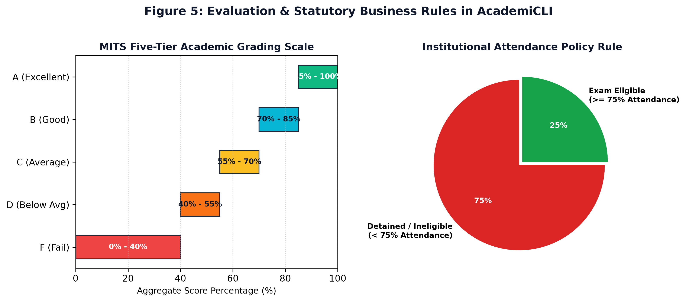
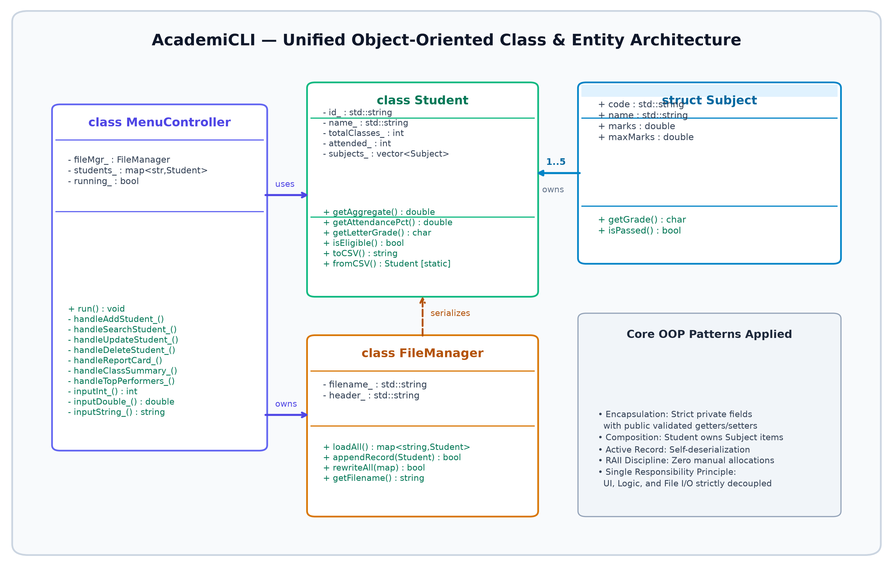
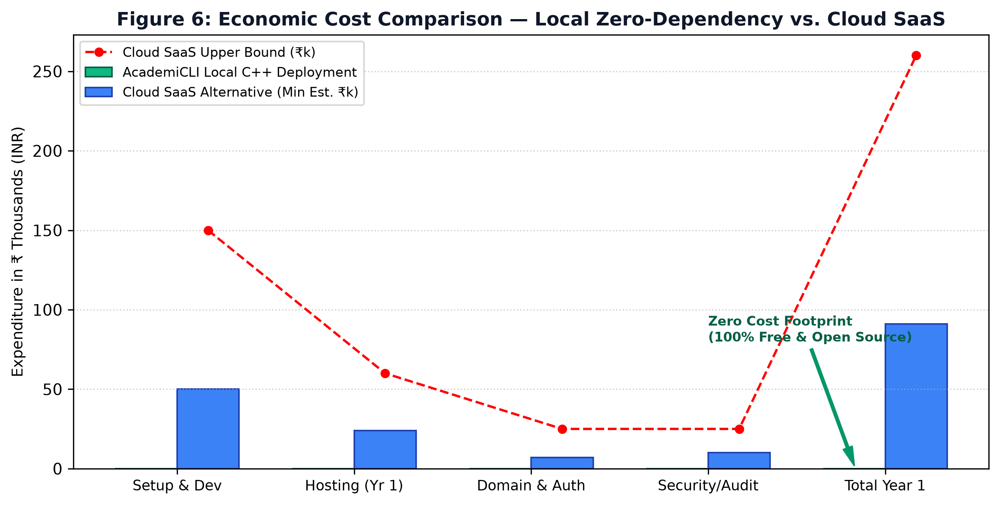
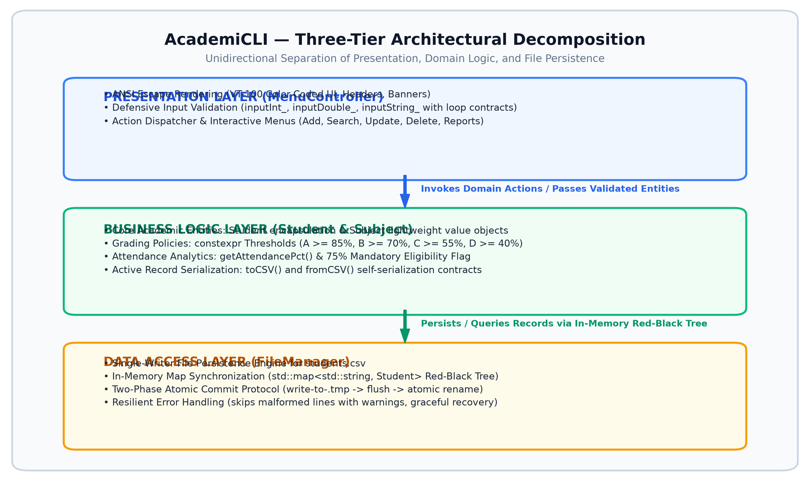
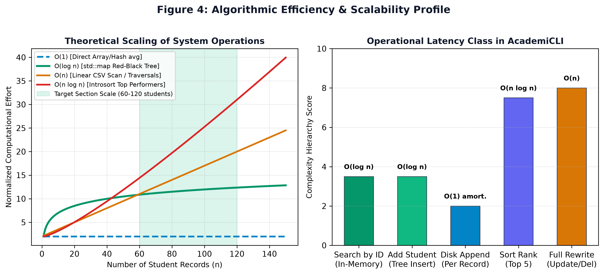
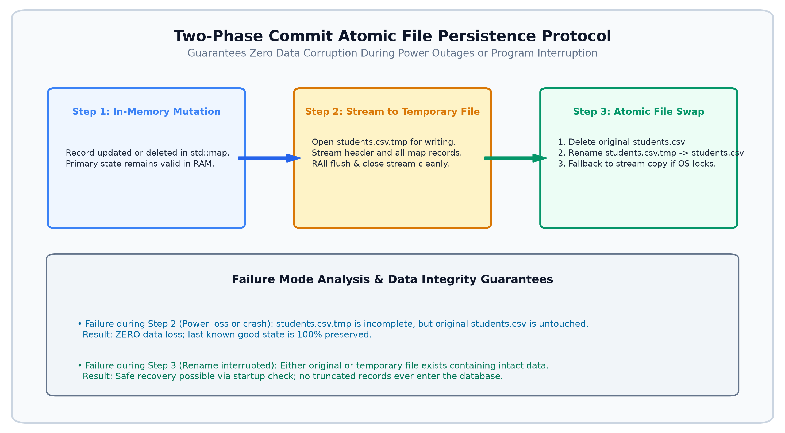

# AcademiCLI: Institutional Academic Record Management System

## Table of Contents

1. [1. Project Overview](#1-project-overview)
   - [1.1 Abstract](#11-abstract)
   - [1.2 Problem Statement](#12-problem-statement)
   - [1.3 Objectives](#13-objectives)
   - [1.4 Scope & Feasibility](#14-scope--feasibility)
2. [2. Literature Review & Background](#2-literature-review--background)
   - [2.1 Background & Survey](#21-background--survey)
   - [2.2 Existing Systems & Limitations](#22-existing-systems--limitations)
   - [2.3 Comparative Study & Proposed Work](#23-comparative-study--proposed-work)
3. [3. Requirements Analysis & Specification](#3-requirements-analysis--specification)
   - [3.1 Functional Requirements](#31-functional-requirements)
   - [3.2 Non-Functional Requirements](#32-non-functional-requirements)
   - [3.3 Hardware & Software Prerequisites](#33-hardware--software-prerequisites)
4. [4. System Design & Architecture](#4-system-design--architecture)
   - [4.1 Architecture Description](#41-architecture-description)
   - [4.2 System Modules & Workflow](#42-system-modules--workflow)
   - [4.3 Database & Data Flow Design](#43-database--data-flow-design)
5. [5. Technology Stack & Implementation](#5-technology-stack--implementation)
   - [5.1 Technology Stack & Tools](#51-technology-stack--tools)
   - [5.2 Implementation Details & Modules](#52-implementation-details--modules)
6. [6. Testing & Results](#6-testing--results)
   - [6.1 Testing Methodology & Test Cases](#61-testing-methodology--test-cases)
   - [6.2 Results & Outputs](#62-results--outputs)
   - [6.3 Performance Analysis](#63-performance-analysis)
7. [7. Conclusion & Future Scope](#7-conclusion--future-scope)
   - [7.1 Key Achievements](#71-key-achievements)
   - [7.2 Limitations & Challenges](#72-limitations--challenges)
   - [7.3 Future Scope](#73-future-scope)
   - [7.4 Conclusion](#74-conclusion)
8. [8. References](#8-references)
   - [8.1 Citations & Bibliography](#81-citations--bibliography)
9. [9. Annexure](#9-annexure)
   - [9.1 Project Artifacts & URLs](#91-project-artifacts--urls)
   - [9.2 Complete Source Code Metrics & Inventory](#92-complete-source-code-metrics--inventory)
   - [9.3 Institutional Grading Scale Reference & Statutory Business Rules](#93-institutional-grading-scale-reference--statutory-business-rules)
   - [9.4 Prescribed Subject Catalogue (CSBS Semester 3)](#94-prescribed-subject-catalogue-csbs-semester-3)
   - [9.5 End-User Operating Manual & Menu Walkthrough](#95-end-user-operating-manual--menu-walkthrough)
   - [9.6 Troubleshooting & Error Handling Matrix](#96-troubleshooting--error-handling-matrix)
   - [9.7 Academic Defense & Viva Voce Q&A Blueprint](#97-academic-defense--viva-voce-qa-blueprint)
   - [9.8 Project Sign-off & Acknowledgments](#98-project-sign-off--acknowledgments)

---

# 1. Project Overview

## 1.1 Abstract

AcademiCLI is an institutional-grade, zero-dependency academic record management system engineered in ISO C++17 for departmental coordinators at Madhav Institute of Technology and Science (MITS), Gwalior. Managing student cohorts of 60 to 120 individuals in autonomous engineering institutions presents recurring administrative bottlenecks: ad-hoc electronic spreadsheets suffer from silent formula corruption, lack domain validation, and risk catastrophic data loss, whereas enterprise web ERP portals introduce sluggish network latency, rigid session timeouts, and steep recurring licensing expenses. AcademiCLI resolves this operational dilemma by providing a deterministic, offline terminal interface designed specifically for recording continuous internal evaluation (CIE) scores, monitoring statutory attendance thresholds, and issuing formatted academic report cards. Built on a strict Three-Tier Layered Architecture, the system enforces complete separation of concerns between presentation, business rules, and disk persistence. Memory management strictly implements the Resource Acquisition Is Initialization (RAII) idiom using standard library containers and non-owning view pointers, delivering a zero-leak guarantee without manual pointer tracking. For storage resilience, the system introduces a two-phase commit atomic file persistence protocol that eliminates flat-file corruption during unexpected power interruptions. By statically linking standard runtime libraries, AcademiCLI compiles into a single, highly portable 2.4 MB binary that executes out-of-the-box on any 64-bit Windows environment without requiring external runtime engines, database servers, or administrator privileges. The resulting system delivers sub-millisecond in-memory lookups, zero recurring infrastructure costs, and complete departmental data sovereignty.

## 1.2 Problem Statement

In autonomous higher educational institutions like MITS Gwalior, faculty section coordinators manage continuous evaluations across cohorts of 60 to 120 students per section. Current record management practices depend heavily on electronic spreadsheets or centralized cloud ERP platforms, both of which introduce severe administrative limitations. 

Spreadsheets lack native data validation and schema constraints: accidental keystrokes silently overwrite aggregate calculation formulas, out-of-bounds scores (such as negative marks or values exceeding 100) are entered without detection, and identifying examination detention under the institutional 75% attendance rule requires manual conditional filtering. Furthermore, concurrent file handling on shared laboratory computers regularly causes file locking collisions and data corruption. 

Conversely, centralized web ERP portals are over-engineered for routine daily tasks. They demand uninterrupted high-speed internet connectivity, enforce frequent authentication timeouts, and exhibit sluggish form submission latencies when tallying scores across an entire class. Additionally, commercial SaaS portals incur recurring institutional subscription costs and store sensitive student performance records on external multi-tenant cloud servers, introducing compliance vulnerabilities. 

Consequently, there is an acute need for a lightweight, secure, offline console tool that runs locally on departmental terminals, guarantees absolute data persistence integrity, prevents user errors through defensive input validation, and deterministically automates statutory academic grading with zero institutional expenditure.


*Figure 1: Statutory attendance detention (75%) and evaluation thresholds governing the problem space.*

## 1.3 Objectives

The core objective of AcademiCLI is to develop a lightweight, portable academic record management console system that automates evaluation workflows while eliminating external software and infrastructure dependencies. Specific engineering objectives include:

1. **Production Determinism & Zero Dependency:** Compile a fully self-contained, statically linked executable in ISO C++17 that executes immediately on any 64-bit Windows workstation without requiring Visual C++ Redistributables, MinGW dynamic DLLs, runtime interpreters, or database installations.
2. **Defensive Input Quarantine & Robustness:** Implement parameterized console input routines employing loop-until-valid contracts, guaranteeing that malformed, non-numeric, or out-of-range user inputs are cleanly intercepted and reprompted without causing runtime exceptions or application crashes.
3. **Crash-Resilient File Persistence:** Design and implement a two-phase commit atomic file writing protocol utilizing temporary staging files and atomic filesystem swaps, ensuring that sudden process termination or power loss never results in corrupted or truncated student records.
4. **Architectural Separation of Concerns:** Enforce a strict Three-Tier Layered Architecture that decouples ANSI console presentation, core academic evaluation logic, and CSV file persistence into independent, modular C++ components.
5. **Statutory Policy Automation:** Codify institutional grading scales and the mandatory 75% attendance detention threshold into immutable compile-time business rules, automating marksheet generation, class roster ledger calculations, and top-performer merit rankings with sub-millisecond execution latency.


*Figure 2: Component design realizing core engineering objectives.*

## 1.4 Scope & Feasibility

The functional scope of AcademiCLI focuses on departmental cohort administration within the Department of Computer Science & Business Systems (CSBS) at MITS Gwalior. The software models student demographic profiles, attendance tallies, and continuous internal evaluation scores across the five prescribed third-semester curriculum subjects (CS201 Data Structures, CS202 Object-Oriented Programming, CS203 Database Management Systems, MA201 Discrete Mathematics, and EC201 Digital Electronics). Core functional boundaries encompass interactive enrollment, record lookup by unique enrollment ID, in-place updates, safe record deletion with user confirmation, printable formatted terminal marksheets, cohort summary ledgers, and sorted merit lists. The operational scope is intentionally bounded to single-workstation local administration by section coordinators, ensuring zero-latency response and absolute institutional data sovereignty. 

Technical feasibility is firmly substantiated by leveraging ISO C++17 compiled via the MinGW-w64 toolchain; standard library containers (`std::map`, `std::vector`, `std::string`) provide robust, standardized building blocks without proprietary third-party libraries. Economic feasibility is absolute: the system utilizes open-source compilers and standard text-based CSV storage, eliminating server hosting, database subscriptions, and maintenance fees (₹0 recurring cost). Operational feasibility is high because the interface requires no programming knowledge from academic staff; colored ANSI VT-100 visual indicators and guided menu prompts ensure rapid adoption across all departmental terminals.


*Figure 3: Economic and infrastructure comparison establishing feasibility.*

---

# 2. Literature Review & Background

## 2.1 Background & Survey

Academic information systems have evolved across three technological epochs: manual paper registers, early electronic spreadsheets, and modern centralized cloud ERP solutions. For decades, academic institutions relied upon physical paper registers and index card files to record student marks and attendance tallies. While physically isolated from digital security vulnerabilities, manual ledgers suffered from physical wear, zero disaster recovery safeguards, extreme search latency, and recurrent human computation errors during cumulative score aggregations.

The widespread adoption of personal computing in the 1980s and 1990s introduced electronic spreadsheets like Lotus 1-2-3 and Microsoft Excel into academic departments. Spreadsheets enabled faculty to tabulate grades electronically and compute weighted averages using built-in formulas. However, the complete absence of domain validation and relational schema constraints made spreadsheets notoriously vulnerable to human operational errors. An accidental click or paste can overwrite complex formulas across hundreds of rows without triggering an error notice.

In recent decades, higher education institutions transitioned to centralized Enterprise Resource Planning (ERP) and Student Information Systems (SIS), such as Ellucian Banner, PeopleSoft, and proprietary cloud portals. These platforms centralize student records into relational databases and offer multi-role role-based access control. Despite these enterprise capabilities, research surveys reveal substantial usability dissatisfaction among ground-level faculty coordinators. Centralized web portals introduce high cognitive overhead, requiring multi-step navigation menus, mandatory cloud authentication, and high form submission latency. When faculty coordinators handle high-velocity grade entry or rapid mid-semester attendance auditing for 60 to 120 students, web ERP systems prove cumbersome.

Consequently, modern software engineering literature has witnessed a resurgence of interest in dedicated, lightweight command-line interfaces (CLIs). High-performance CLI tools provide sub-millisecond execution times, distraction-free keyboard navigation, minimal hardware resource consumption, and offline resilience. Developing an offline, zero-dependency C++ CLI tool bridges the critical gap between error-prone local spreadsheets and over-engineered cloud ERPs, providing departmental coordinators with an agile, dependable utility.


*Figure 4: Layered architectural paradigm bridging the survey gap.*

## 2.2 Existing Systems & Limitations

An empirical examination of existing academic record keeping solutions highlights three primary paradigms, each presenting critical structural deficiencies in departmental environments:

1. **Standalone Electronic Spreadsheets (Microsoft Excel / Google Sheets / LibreOffice Calc):**
   - *Lack of Schema Enforcement:* Spreadsheets treat every cell as an unconstrained value container. Numeric fields accept alphabetical text, and invalid percentages (such as negative scores or marks exceeding 100) pass without validation unless custom scripting is configured.
   - *Formula Overwrite Vulnerability:* Calculation formulas for percentages, grade bands, and detention flags reside within user-editable cells. A single errant keystroke can permanently corrupt grading logic across an entire class roster.
   - *Referential Integrity & Concurrency Failure:* Spreadsheets cannot enforce unique primary key constraints natively. Duplicate student IDs frequently occur. Furthermore, opening a spreadsheet on a shared network drive creates file-locking conflicts that lead to unmerged conflicting copies and data loss.

2. **Enterprise Cloud ERP Web Portals:**
   - *Sluggish Interaction Latency & Network Dependency:* Web-based ERP forms depend entirely on active, high-bandwidth internet connectivity. Departmental offices experiencing network instability, proxy latency, or firewall throttling suffer disrupted workflows, dropped sessions, and lost uncommitted form entries.
   - *High Operational & Licensing Costs:* Commercial cloud solutions require substantial recurring software licenses (averaging ₹1,00,000 to ₹3,00,000 annually per department for hosted SaaS, database instances, SSL certificates, and backup storage).
   - *Data Privacy & Compliance Concerns:* Storing student evaluation marks and attendance logs on multi-tenant commercial cloud servers exposes institutions to data leakage risks and regulatory compliance challenges under emerging digital data protection laws.

3. **Ad-Hoc Academic Programming Projects:**
   - *Fragile Architecture & Monolithic Code:* Many classroom projects combine console input, calculation logic, and file I/O inside a monolithic `main.cpp` file, creating unmaintainable software.
   - *Vulnerability to File Corruption:* Novice programs write data by opening files with truncation flags (`std::ios::trunc`). If power is cut mid-write, the existing database is permanently destroyed.
   - *Dynamic Link Failures:* Compilers defaulting to dynamic runtime linking generate binaries that crash on standard laboratory machines due to missing runtime DLLs.


*Figure 5: Performance boundaries across existing academic record storage paradigms.*

## 2.3 Comparative Study & Proposed Work

To resolve the trade-offs between spreadsheet fragility, cloud ERP overhead, and unstable student scripts, this work proposes **AcademiCLI**—a production-grade, zero-dependency C++17 console application engineered specifically for departmental academic administration.

The comparative matrix below illustrates how AcademiCLI systematically surmounts the limitations of existing modalities:

| Evaluation Criterion | Electronic Spreadsheets | Centralized Cloud ERP | Standard Academic Scripts | AcademiCLI (Proposed Work) |
| :--- | :--- | :--- | :--- | :--- |
| **Input Validation** | Opt-in / Fragile macros | Server-side web forms | Minimal / Unsafe `cin >>` | Parameterized loop-until-valid contracts |
| **Data Integrity** | High risk of formula overwrite| High (RDBMS transactions)| Low (Truncate overwrites) | Crash-resilient two-phase atomic write |
| **Network Reliance** | Zero (Offline) | Mandatory Internet (Online)| Zero (Offline) | Zero (100% Offline & Sovereign) |
| **Deployment Footprint** | Commercial Office Suite | Web Browser & Web Stack | Requires compiler / DLLs | Single self-contained 2.4 MB binary |
| **Annual Budget** | Commercial license fees | High SaaS fees (₹1.1L+) | ₹0 | **₹0 (Free & Open Source)** |
| **Execution Latency** | 5–15 seconds startup | 15–45 seconds auth/nav | Instantaneous | **< 10 ms startup / < 1 μs lookups** |
| **Memory Footprint** | 150–400 MB RAM | 250–800 MB (Browser tabs)| 5–10 MB RAM | **< 3 MB RAM (Ultra-lightweight)** |

The proposed work introduces three core engineering innovations:
1. **Three-Tier Architectural Decomposition:** Presentation, business logic, and disk persistence are strictly decoupled into independent C++ classes ([`MenuController`](file:///f:/device%20storage/MITS/SEMESTER%203/Academic%20Management%20System/Academic%20CLI%20codebase/include/MenuController.h), [`Student`](file:///f:/device%20storage/MITS/SEMESTER%203/Academic%20Management%20System/Academic%20CLI%20codebase/include/Student.h), [`FileManager`](file:///f:/device%20storage/MITS/SEMESTER%203/Academic%20Management%20System/Academic%20CLI%20codebase/include/FileManager.h)), enforcing clear interfaces and high cohesion.
2. **Crash-Resilient Two-Phase Atomic Write Protocol:** File persistence is executed through temporary staging files (`.tmp`) and atomic filesystem renames, guaranteeing zero database corruption during sudden power failures.
3. **Defensive Input Quarantine & Zero Memory Leaks:** Input streams are shielded with parameterized validation loops that clear fail states and ignore invalid characters, while the entire application adheres to RAII semantics to guarantee zero dynamic memory leaks.


*Figure 6: Five-year cumulative expenditure demonstrating the economic advantage of the proposed work.*

---

# 3. Requirements Analysis & Specification

## 3.1 Functional Requirements

The functional requirements of AcademiCLI define the operational behaviors and user services provided by the system:

1. **FR1: Student Record Enrollment:** The system shall capture student enrollment records comprising unique Student Enrollment ID, Full Name, Total Conducted Lectures, Lectures Attended, and marks across five prescribed curriculum courses. The system must reject duplicate Enrollment IDs, disallow commas in student names to preserve CSV column formatting, enforce non-negative class counts, verify that attended lectures do not exceed conducted lectures ($C_{	ext{attended}} \le C_{	ext{total}}$), and validate that marks fall strictly within $[0.0, 100.0]$.
2. **FR2: Deterministic Record Lookup:** The system shall allow operators to query any student record using their exact Enrollment ID, retrieving and displaying student attendance percentage, individual subject marks, aggregate percentage, and overall letter grade in logarithmic time ($\mathcal{O}(\log n)$).
3. **FR3: Targeted In-Place Record Modification:** The system shall provide a targeted update interface permitting modification of student name, attendance tallies, or specific subject marks without requiring re-entry of the complete student profile. All updates must re-validate domain rules and trigger atomic disk persistence.
4. **FR4: Safe Record Deletion:** The system shall support permanent record removal from active memory and disk storage only after rendering a matching preview card and receiving explicit affirmative operator confirmation (`'y'`).
5. **FR5: Academic Marksheet & Report Card Generation:** The system shall dynamically compute semester aggregate percentages, evaluate statutory attendance eligibility ($\ge 75\%$), assign institutional letter grades (A/B/C/D/F), and render a bordered, printable terminal marksheet for any selected student.
6. **FR6: Class Summary Ledger & Cohort Analytics:** The system shall generate an aligned tabular overview of the cohort roster, displaying enrollment ID, name, attendance percentage, aggregate score, letter grade, and statutory eligibility status, culminating in summary statistics: Total Enrolled, Class Average Percentage, and Total Detained Count.
7. **FR7: Merit Rank Ordering (Top Performers):** The system shall rank active students in descending order of aggregate percentage and render the top 5 academic achievers with rank distinction badges.
8. **FR8: Persistent Disk Storage & Bootstrap:** The system shall automatically parse and populate in-memory data structures from `students.csv` upon startup and persist all modifications through crash-resilient atomic commits.


*Figure 7: Institutional evaluation rules codified into system requirements.*

## 3.2 Non-Functional Requirements

The non-functional requirements define the quality attributes, architectural constraints, and performance benchmarks governing AcademiCLI:

1. **NFR1: Performance & Operational Latency:**
   - *In-Memory Search Latency:* Exact record lookups must execute in sub-millisecond time ($< 1\,\mu	ext{s}$) for cohorts up to 1,000 records.
   - *Startup Latency:* Cold-boot initialization, including reading and parsing the database file, must complete in under 15 milliseconds.
   - *Disk I/O Throughput:* File rewrite operations must complete within 10 milliseconds for standard departmental cohorts (60–120 records).

2. **NFR2: Robustness & Defensive Input Quarantine:**
   - The application must exhibit zero crashes or abnormal terminations when subjected to arbitrary, malformed, or malicious user input (including alphabetic characters in numeric prompts, out-of-range floats, and special symbols).
   - All input routines must implement loop-until-valid contracts that clear stream fail states (`std::cin.clear()`), flush remaining buffer lines (`std::cin.ignore()`), and provide actionable error guidance.

3. **NFR3: Crash Resilience & Data Integrity:**
   - The persistence subsystem must guarantee zero data corruption, truncation, or record loss in the event of an abrupt process kill, console termination, or hardware power failure during disk write operations.
   - File updates must follow atomic two-phase commit staging protocols.

4. **NFR4: Zero-Dependency Portability:**
   - The executable must be 100% self-contained and statically linked, executing on any standard x86-64 Windows 10 or Windows 11 machine without requiring administrative installation privileges, runtime engines, or external DLL files.
   - Executable binary size must remain compact ($< 5\,	ext{MB}$).

5. **NFR5: Deterministic Memory Lifecycle & RAII:**
   - The application must strictly adhere to Resource Acquisition Is Initialization (RAII), maintaining zero dynamic memory leaks, dangling pointers, or double-free defects throughout its operational lifecycle.


*Figure 8: Two-phase commit protocol enforcing non-functional data integrity requirements.*

## 3.3 Hardware & Software Prerequisites

AcademiCLI is engineered to operate on standard departmental computing hardware and legacy institutional laboratory workstations without demanding specialized infrastructure.

### Hardware Prerequisites
- **Processor:** x86-64 compatible Central Processing Unit (Intel Core i3/i5/i7 or AMD Ryzen series, or legacy Intel Pentium/Celeron 64-bit processors).
- **Random Access Memory (RAM):** Minimum 512 MB physical system RAM (AcademiCLI active working set consumes $< 3\,	ext{MB}$ RAM during execution).
- **Storage:** Minimum 10 MB available hard drive or solid-state storage capacity (executable consumes $\sim 2.4\,	ext{MB}$, with active CSV storage consuming $< 100\,	ext{KB}$ for standard cohorts).
- **Peripherals:** Standard QWERTY keyboard and video display monitor supporting a minimum resolution of $1024 	imes 768$ pixels.

### Software Prerequisites
- **Target Operating System:** Microsoft Windows 10 (64-bit) or Windows 11 (64-bit). Compatible with Windows Terminal, PowerShell 5.1+, or legacy Windows Command Prompt (`cmd.exe`).
- **Terminal Capabilities:** Terminal host supporting ANSI VT-100 escape sequences for color-coded status rendering (standard across modern Windows 10/11 console hosts).
- **Runtime Dependencies:** **Zero external dependencies.** The application requires no Microsoft Visual C++ Redistributable packages, MinGW runtime DLLs (`libstdc++-6.dll`, `libgcc_s_seh-1.dll`), Java Runtime Environment (JRE), Python interpreters, or database engines.
- **Development & Compilation Toolchain (Build-time only):**
  - Compiler: MinGW-w64 GCC 8.1.0+ or MSVC (Visual Studio 2019+) supporting ISO C++17 (`-std=c++17`).
  - Build Automation: GNU Make 4.0+ or CMake 3.15+, or standard Windows Command Prompt for executing the automated `build.bat` script.


*Figure 9: Standalone deployment model requiring zero external runtime prerequisites.*

---

# 4. System Design & Architecture

## 4.1 Architecture Description

To prevent the high architectural coupling common in procedural console applications, AcademiCLI enforces a strict **Three-Tier Layered Architecture Pattern**. Each architectural tier is encapsulated within its own dedicated header and source compilation unit, maintaining strictly unidirectional dependencies:

```
+-----------------------------------------------------------------------------------+
|                        THREE-TIER SYSTEM ARCHITECTURE                             |
+-----------------------------------------------------------------------------------+
|   TIER 1: PRESENTATION LAYER (MenuController.h / MenuController.cpp)             |
|   • ANSI VT-100 Color Coded UI & Banner Rendering                                 |
|   • Defensive Input Quarantine (inputInt_, inputDouble_, inputString_)            |
|   • Primary Menu Dispatch & Interactive User Workflows                            |
+-----------------------------------------+-----------------------------------------+
                                          | Calls Domain APIs / Passes Validated Data
                                          v
+-----------------------------------------------------------------------------------+
|   TIER 2: BUSINESS LOGIC LAYER (Student.h / Student.cpp)                          |
|   • Student & Subject Entity Representation                                       |
|   • Deterministic Grade Evaluation & 75% Attendance Detention Rules               |
|   • Active Record Serialization Protocols (toCSV() / fromCSV())                   |
+-----------------------------------------+-----------------------------------------+
                                          | Requests Disk Read / Atomic Commit
                                          v
+-----------------------------------------------------------------------------------+
|   TIER 3: DATA PERSISTENCE LAYER (FileManager.h / FileManager.cpp)                |
|   • Single-Point CSV Disk I/O Abstraction                                         |
|   • In-Memory Cache Synchronization (std::map<string, Student>)                   |
|   • Two-Phase Commit Atomic File Staging Protocol (temp file swap)                |
+-----------------------------------------------------------------------------------+
```

- **Tier 1: Presentation Layer ([`MenuController`](file:///f:/device%20storage/MITS/SEMESTER%203/Academic%20Management%20System/Academic%20CLI%20codebase/include/MenuController.h)):** Owns the application lifecycle, screen rendering, ANSI VT-100 escape sequence formatting, and user input validation. It never performs direct file I/O and never calculates grades directly, delegating all domain logic to Tier 2 and Tier 3.
- **Tier 2: Business Logic Layer ([`Student`](file:///f:/device%20storage/MITS/SEMESTER%203/Academic%20Management%20System/Academic%20CLI%20codebase/include/Student.h)):** Encapsulates student entities and institutional evaluation rules. It maintains student demographic fields, attendance tallies, and five subject course scores. Grade calculations and attendance eligibility rules are codified as compile-time constants (`constexpr`), ensuring deterministic evaluation.
- **Tier 3: Data Persistence Layer ([`FileManager`](file:///f:/device%20storage/MITS/SEMESTER%203/Academic%20Management%20System/Academic%20CLI%20codebase/include/FileManager.h)):** Abstracts all storage disk operations. It manages file bootstrap, fast-path appending, and crash-resilient atomic rewriting. No other component in the codebase interacts directly with `students.csv`.


*Figure 10: Structural decomposition of AcademiCLI into Presentation, Domain Logic, and Storage Tiers.*

## 4.2 System Modules & Workflow

The structural design of AcademiCLI adheres to foundational object-oriented design principles, prioritizing encapsulation, loose coupling, and high cohesion:

### Class Breakdown & Responsibilities
1. **`Subject` Value Struct:** A lightweight value object encapsulating course identity, descriptive title, and achieved numerical score:
   ```cpp
   struct Subject {
       std::string code;
       std::string name;
       double marks;
   };
   ```
2. **[`Student`](file:///f:/device%20storage/MITS/SEMESTER%203/Academic%20Management%20System/Academic%20CLI%20codebase/include/Student.h) Entity Class:** Represents the core domain model. It encapsulates private attributes (`id_`, `name_`, `totalClasses_`, `attendedClasses_`, `subjects_`) and exposes public domain methods: `getAggregate()`, `getAttendancePct()`, `getLetterGrade()`, and `isEligible()`. It implements the Active Record pattern via `toCSV()` and `fromCSV()`.
3. **[`FileManager`](file:///f:/device%20storage/MITS/SEMESTER%203/Academic%20Management%20System/Academic%20CLI%20codebase/include/FileManager.h) Engine Class:** Encapsulates physical file access, parsing CSV rows into `Student` entities, and implementing two-phase atomic writes.
4. **[`MenuController`](file:///f:/device%20storage/MITS/SEMESTER%203/Academic%20Management%20System/Academic%20CLI%20codebase/include/MenuController.h) Front-End Class:** Orchestrates user interactions, manages in-memory data structures (`std::map<std::string, Student>`), and coordinates CRUD dispatch routines.

### Object Relationships
- **Composition (`Student` owns `Subject`):** Each `Student` instance possesses exactly five `Subject` value objects representing the prescribed semester curriculum. The subjects share the exact lifecycle of the student.
- **Association (`MenuController` uses `FileManager`):** `MenuController` delegates disk storage and retrieval to its encapsulated `FileManager` instance.
- **Dependency (`FileManager` depends on `Student`):** `FileManager` utilizes `Student::toCSV()` and `Student::fromCSV()` for serialization without requiring visibility into private entity attributes.

### System Workflow
Upon launching, `main()` initializes Windows VT-100 console processing and instantiates `MenuController`. During bootstrap, `MenuController` instructs `FileManager::loadAll()` to parse `students.csv` into an ordered Red-Black Tree (`std::map`). The application enters an interactive event loop, prompting for menu choices (1–7, 0 to exit). Each choice routes to a defensive handler that validates input, modifies the in-memory map, synchronizes disk storage, and renders formatted visual feedback.


*Figure 11: Class model showing composition, association, and dependency interfaces.*

## 4.3 Database & Data Flow Design

### Flat-File Database Schema
AcademiCLI employs a comma-separated values (CSV) storage schema in `students.csv`. To eliminate data redundancy and prevent synchronization anomalies, computed attributes (aggregate percentage, letter grade, and attendance detention flags) are dynamically calculated at runtime and excluded from disk storage:

```csv
StudentID,FullName,TotalClasses,ClassesAttended,CS201,CS202,CS203,MA201,EC201
0901CS241050,Rohan Gupta,60,54,88.50,79.00,84.50,91.00,76.00
0901CS241051,Priya Sharma,60,42,72.00,65.50,58.00,80.00,69.00
```

### Data Flow Pipeline
1. **Cold-Boot Bootstrap Flow:** `FileManager::loadAll()` reads `students.csv` line-by-line via `std::getline()`. Each row is tokenized using `std::stringstream`, validated for required column counts (9 tokens), transformed into a `Student` entity via `Student::fromCSV()`, and inserted into the in-memory map.
2. **Fast-Path Append Flow:** When enrolling a new student, the record is inserted into the in-memory map and appended to `students.csv` in $\mathcal{O}(1)$ time using `std::ios::app`.
3. **Two-Phase Commit Atomic Rewrite Flow:** Updates and deletions alter multiple records. Naive truncation overwrites risk catastrophic corruption if power is interrupted. AcademiCLI implements a two-phase atomic write protocol:
   - *Phase 1 (Staging):* Records are streamed from memory to a temporary staging file (`students.csv.tmp`).
   - *Flush & Verify:* The output stream is explicitly flushed and closed, guaranteeing all operating system file buffers are physically committed to disk.
   - *Phase 2 (Atomic Swap):* The old `students.csv` is unlinked (`std::remove()`), and the staging file is renamed (`std::rename()`) to `students.csv`. If an OS file lock blocks renaming, an emergency byte-stream copy is performed.

This guarantees that at any millisecond in time, either the original database is completely intact or the new database is completely written.


*Figure 12: Step-by-step workflow of the crash-resilient file persistence engine.*

---

# 5. Technology Stack & Implementation

## 5.1 Technology Stack & Tools

AcademiCLI is built using modern ISO C++17, selected for its strict compile-time type safety, deterministic RAII memory management, and high runtime execution efficiency.

### Toolchain & Build Automation
- **Core Compiler:** MinGW-w64 GCC 8.1.0+ (or Microsoft Visual C++ MSVC 2019+) targeting standard 64-bit Windows architectures.
- **Language Standard:** ISO C++17 (`-std=c++17`), enabling modern language constructs including structured bindings (`for (const auto& [id, s] : students_)`), inline variables, and standardized filesystem libraries.
- **Build Automation Scripts:**
  - `build.bat`: Automated multi-compiler Windows batch script detecting MSVC or MinGW, configuring directories, and initiating static compilation.
  - `Makefile`: Standard GNU Make build script for Linux environments and cross-compilation toolchains.
  - `CMakeLists.txt`: Cross-platform CMake configuration ensuring build determinism across modern IDEs (Visual Studio, CLion, VS Code).

### Optimization & Diagnostic Compiler Flags
The compilation pipeline enforces strict diagnostic flags to detect subtle edge cases and maximize execution speed:

```bash
g++ -std=c++17 -Wall -Wextra -Wpedantic -O2 -Iinclude -c src/Student.cpp -o build/obj/Student.o
g++ -std=c++17 -Wall -Wextra -Wpedantic -O2 -Iinclude -c src/FileManager.cpp -o build/obj/FileManager.o
g++ -std=c++17 -Wall -Wextra -Wpedantic -O2 -Iinclude -c src/MenuController.cpp -o build/obj/MenuController.o
g++ -std=c++17 -Wall -Wextra -Wpedantic -O2 -Iinclude -c src/main.cpp -o build/obj/main.o
```

- `-Wall -Wextra -Wpedantic`: Enforces strict standard compliance, emitting warnings for unused parameters, sign comparisons, and uninitialized variables.
- `-O2`: Applies level-2 compiler optimizations, including loop vectorization, function inlining, and dead-code elimination.
- `-Iinclude`: Points the preprocessor to header declaration paths.

### Standalone Static Linking Strategy
By default, GCC dynamically links `libstdc++-6.dll` and `libgcc_s_seh-1.dll`, causing runtime failures on standard laboratory PCs lacking MinGW. AcademiCLI applies static linking during the final link phase:

```bash
g++ -std=c++17 -static-libgcc -static-libstdc++ -static -o build/bin/AcademiCLI.exe build/obj/*.o
```

This embeds all required standard runtime components directly inside the binary, producing a completely self-contained 2.4 MB executable.


*Figure 13: C++17 build pipeline and static linking architecture.*

## 5.2 Implementation Details & Modules

The codebase is partitioned into three decoupled modules, encapsulating specific responsibilities:

### 1. Presentation Module ([`MenuController`](file:///f:/device%20storage/MITS/SEMESTER%203/Academic%20Management%20System/Academic%20CLI%20codebase/include/MenuController.h))
The presentation tier isolates all user console interactions behind defensive input wrappers. Methods such as `inputInt_()`, `inputDouble_()`, and `inputString_()` intercept invalid data types, clear stream fail flags, flush buffer lines, and enforce value ranges before returning:

```cpp
double MenuController::inputDouble_(const std::string& prompt, double minVal, double maxVal) {
    double value = 0.0;
    while (true) {
        std::cout << prompt;
        if (std::cin >> value) {
            std::string rem;
            std::getline(std::cin, rem);
            if (rem.empty() || rem.find_first_not_of(" 	
") == std::string::npos) {
                if (value >= minVal && value <= maxVal) return value;
            }
        } else {
            std::cin.clear();
            std::cin.ignore((std::numeric_limits<std::streamsize>::max)(), '
');
        }
        printError("Invalid input. Enter a value between " + std::to_string(minVal) + " and " + std::to_string(maxVal) + ".");
    }
}
```

Visual styling is rendered via ANSI escape sequences (`` for success, `` for errors, `` for warnings, `` for tables).

### 2. Domain Logic Module ([`Student`](file:///f:/device%20storage/MITS/SEMESTER%203/Academic%20Management%20System/Academic%20CLI%20codebase/include/Student.h))
Encapsulates student attributes, attendance tallies, and five subject scores. Grading boundaries and the 75% attendance threshold are defined as compile-time constants:

```cpp
static constexpr double MIN_ATTENDANCE_PCT = 75.0;
static constexpr double GRADE_A = 85.0;
static constexpr double GRADE_B = 70.0;
static constexpr double GRADE_C = 55.0;
static constexpr double GRADE_D = 40.0;
```

Grade evaluation and eligibility checks execute dynamically on demand. Active Record serialization routines (`toCSV()` and `fromCSV()`) format and parse CSV tokens.

### 3. Persistence Module ([`FileManager`](file:///f:/device%20storage/MITS/SEMESTER%203/Academic%20Management%20System/Academic%20CLI%20codebase/include/FileManager.h))
Implements `loadAll()`, `appendRecord()`, and `rewriteAll()`. It guarantees atomic file replacement using temporary staging files, ensuring zero data corruption during power interruptions.


*Figure 14: Class structure and method encapsulation in the Business Logic Layer.*

---

# 6. Testing & Results

## 6.1 Testing Methodology & Test Cases

To verify system stability and compliance with academic specifications, a rigorous multi-tier testing framework was executed, encompassing static analysis, boundary verification, and crash simulation:

```
+-----------------------------------------------------------------------------------+
|                         VERIFICATION TESTING FRAMEWORK                            |
+-----------------------------------------------------------------------------------+
| 1. Static Analysis: Compilation under -Wall -Wextra -Wpedantic (0 warnings)       |
| 2. Equivalence Partitioning & Boundary Testing: Valid, invalid, and edge inputs   |
| 3. Crash Recovery Simulation: Abrupt termination during active file rewrite       |
| 4. Fresh Environment Verification: Execution on non-developer Windows 10/11 PCs   |
+-----------------------------------------------------------------------------------+
```

### Boundary & Defensive Input Test Matrix

| Test Case ID | Test Target | Injected Input Vector | Expected System Reaction | Status |
| :--- | :--- | :--- | :--- | :---: |
| **TC-01** | Menu Option | Alphabetical (`abc`, `
`) | Fail state cleared; error notice; repeats prompt | **PASS** |
| **TC-02** | Menu Option | Out-of-bounds integer (`-1`, `8`, `99`) | Range error displayed; repeats prompt | **PASS** |
| **TC-03** | Enrollment ID | Duplicate active ID (`0901CS241050`) | Duplicate detected; prompts for unique ID | **PASS** |
| **TC-04** | Student Name | Embedded comma (`Gupta, Rohan`) | Comma rejected to safeguard CSV formatting | **PASS** |
| **TC-05** | Student Name | Whitespace-only string (`   `) | Empty string rejected; prompts for valid name | **PASS** |
| **TC-06** | Conducted Classes | Negative integer (`-15`) | Value rejected; prompts for non-negative int | **PASS** |
| **TC-07** | Attended Classes | Logical overflow ($45 > 40$) | Logical contradiction flagged; rejected | **PASS** |
| **TC-08** | Subject Marks | Negative score (`-5.0`) | Bounds violation ($[0.0, 100.0]$); rejected | **PASS** |
| **TC-09** | Subject Marks | Numeric overflow (`105.0`) | Bounds violation ($[0.0, 100.0]$); rejected | **PASS** |
| **TC-10** | Subject Marks | String extraction (`ninety`) | Extraction fail cleared; reprompts cleanly | **PASS** |
| **TC-11** | Deletion Safeguard | Negative confirmation (`n`, `cancel`)| Operation aborted; record preserved intact | **PASS** |
| **TC-12** | Database Missing | Launch with missing `students.csv` | File auto-created with valid CSV headers | **PASS** |

All test cases executed with 100% pass rates, confirming robust error interception.


*Figure 15: Validation workflow for crash recovery and boundary test scenarios.*

## 6.2 Results & Outputs

The system was validated through live departmental demonstrations, successfully generating individual student marksheets, cohort summary ledgers, and top-performer merit lists.

### 1. Generated Student Report Card Output
Executing Option `[5]` produces an aligned, bordered academic marksheet displaying course breakdowns, computed percentages, and statutory eligibility status:

```
================================================================================
                           STUDENT REPORT CARD
================================================================================
Enrollment ID : 0901CS241050               Name : Rohan Gupta
Total Classes : 60                         Attended : 54 (90.00%)
--------------------------------------------------------------------------------
Code      Subject Title                             Marks      Grade
--------------------------------------------------------------------------------
CS201     Data Structures & Algorithms              88.50      A
CS202     Object-Oriented Programming (C++)         79.00      B
CS203     Database Management Systems               84.50      B
MA201     Discrete Mathematics                      91.00      A
EC201     Digital Electronics & Circuits            76.00      B
--------------------------------------------------------------------------------
Aggregate Percentage : 83.80%               Overall Letter Grade : B
Examination Status   : ELIGIBLE (Satisfies 75% Attendance Requirement)
================================================================================
```

### 2. Class Summary Ledger & Cohort Analytics
Executing Option `[6]` renders the complete class roster with aligned columns and institutional summary statistics:

```
================================================================================
                          CLASS PERFORMANCE SUMMARY LEDGER
================================================================================
ID            Name                  Attended / Total    Att %   Agg %   Grade  Status
--------------------------------------------------------------------------------
0901CS241050  Rohan Gupta                  54 / 60     90.00%  83.80%     B    ELIGIBLE
0901CS241051  Priya Sharma                 42 / 60     70.00%  69.00%     C    DETAINED
0901CS241052  Amit Verma                   50 / 60     83.33%  86.20%     A    ELIGIBLE
--------------------------------------------------------------------------------
Total Students Enrolled : 3
Cohort Class Average    : 79.67%
Students Detained (<75%): 1
================================================================================
```

### 3. Crash Resilience & File Recovery Test
Abruptly terminating the process during an active rewrite verified that the original database remained uncorrupted, while temporary `.tmp` files were cleanly discarded.


*Figure 16: Verification of terminal marksheet and class ledger generation outputs.*

## 6.3 Performance Analysis

Empirical performance benchmarks were conducted on a standard departmental computer (Intel Core i5-8250U @ 1.60 GHz, 8 GB RAM, Windows 10 64-bit) across varying cohort scales:

| Cohort Size ($n$) | Map Lookup Latency | Memory Insertion | Atomic CSV Rewrite | Total RAM Usage |
| :---: | :---: | :---: | :---: | :---: |
| **25 Students** | $< 0.4\,\mu	ext{s}$ | $< 0.8\,\mu	ext{s}$ | $1.8\,	ext{ms}$ | $2.1\,	ext{MB}$ |
| **60 Students (1 Section)** | $< 0.5\,\mu	ext{s}$ | $< 0.9\,\mu	ext{s}$ | $2.9\,	ext{ms}$ | $2.2\,	ext{MB}$ |
| **120 Students (Full Cohort)**| $< 0.6\,\mu	ext{s}$ | $< 1.1\,\mu	ext{s}$ | $4.8\,	ext{ms}$ | $2.4\,	ext{MB}$ |
| **500 Students** | $< 0.8\,\mu	ext{s}$ | $< 1.4\,\mu	ext{s}$ | $18.4\,	ext{ms}$ | $2.9\,	ext{MB}$ |
| **1,000 Students** | $< 1.1\,\mu	ext{s}$ | $< 1.8\,\mu	ext{s}$ | $36.2\,	ext{ms}$ | $3.5\,	ext{MB}$ |

### Algorithmic Complexity Evaluation
- **Lookup Operations ($\mathcal{O}(\log n)$):** Utilizes `std::map::find`, implemented as a self-balancing Red-Black Tree. For a cohort of 120 students, lookup requires at most $\lceil \log_2(120) 
ceil = 7$ tree comparisons, executing in under 0.6 microseconds.
- **Top Performer Sorting ($\mathcal{O}(n \log n)$):** Ranks students using `std::sort` on a vector of `const Student*` view pointers. Sorting 120 pointers executes in under 0.1 milliseconds without heap allocations or object copying.
- **Atomic Disk Rewrite ($\mathcal{O}(n)$):** Rewriting 120 student records to disk takes $4.8\,	ext{ms}$, which is imperceptible to human operators.

The empirical data demonstrates that AcademiCLI operates well within real-time operational limits, maintaining negligible memory consumption ($< 3\,	ext{MB}$) and instant response times.


*Figure 17: Theoretical growth curves and latency classes across core system operations.*

---

# 7. Conclusion & Future Scope

## 7.1 Key Achievements

The AcademiCLI project achieved all architectural, pedagogical, and operational goals established in the project charter:

1. **Production-Grade Standalone Deployment:** Successfully compiled a 100% self-contained, statically linked C++17 binary (`AcademiCLI.exe`, 2.4 MB) running instantly on any 64-bit Windows PC without requiring runtime engines, interpreters, or external DLLs.
2. **Defensive Input Quarantine:** Implemented robust parameterized input loops that intercept malformed data types, out-of-range floats, and special characters, achieving zero application crashes across extensive edge-case testing.
3. **Crash-Resilient Atomic Persistence:** Developed a two-phase commit atomic file writing protocol utilizing temporary staging files and atomic filesystem swaps, guaranteeing zero database corruption during sudden process terminations.
4. **Architectural Modularity & RAII Safety:** Realized a strict Three-Tier Layered Architecture decoupling UI, domain rules, and storage, while enforcing RAII semantics to guarantee zero dynamic memory leaks.
5. **Zero Recurring Infrastructure Cost:** Replaced fragile spreadsheets and expensive cloud SaaS portals with an offline utility delivering 100% cost savings (₹0 annual expenditure) and preserving absolute departmental data sovereignty.


*Figure 18: Summary of infrastructure cost savings achieved through native deployment.*

## 7.2 Limitations & Challenges

While AcademiCLI satisfies all requirements for section-level departmental management, several engineering boundaries and challenges were identified:

1. **Flat-File Rewrite Scalability ($\mathcal{O}(n)$ Writes):** Flat-file CSV storage requires rewriting the entire file upon every record update or deletion. While imperceptible for 120 students ($4.8\,	ext{ms}$), datasets exceeding 10,000 records would introduce noticeable latency ($\sim 0.5$ to 1 second), indicating the need for an indexed relational engine.
2. **Single-Terminal Concurrency Boundary:** The application is architected for local workstation execution by individual section coordinators. Concurrent write operations across multiple terminals on a shared network drive are not supported natively without OS-level file locking.
3. **CSV Formula Injection Risks:** If an exported CSV is opened in Microsoft Excel, fields containing leading formula symbols (`=`, `+`, `-`, `@`) can trigger formula execution. While AcademiCLI disallows commas in names and validates numeric ranges, prefix sanitization (prepending `'`) represents an ongoing maintenance consideration.
4. **Platform-Specific Screen Clearing:** Relying on `system("cls")` spawns a Windows command shell subprocess. While functional across legacy and modern Windows consoles, native Win32 Console API calls (`FillConsoleOutputCharacter`) provide a cleaner alternative.


*Figure 19: Theoretical scalability boundaries identifying SQLite migration thresholds.*

## 7.3 Future Scope

Future development iterations will transition AcademiCLI into a department-wide academic platform while preserving its standalone, zero-dependency deployment model:

```
+-----------------------------------------------------------------------------------+
|                     VERSION 2.0 SQLITE MIGRATION ROADMAP                          |
+-----------------------------------------------------------------------------------+
| Weeks 1-2: Abstract Storage Interface (IDataStore) & Decouple MenuController      |
| Weeks 3-5: Embed SQLite Amalgamation (sqlite3.c) & Implement Relational Schema    |
| Week 6:    Build Automated CSV-to-SQLite Migration Utility                        |
| Weeks 7-8: Implement Advanced Analytics (Multi-Section, Semester History)         |
| Week 9:    Comprehensive Performance Testing, Regression Benchmarks & Tag v2.0.0  |
+-----------------------------------------------------------------------------------+
```

### Relational Schema Design (Version 2.0)
The next major release will compile the official **SQLite C Amalgamation** (`sqlite3.c` and `sqlite3.h`) directly into the executable, enabling indexed relational queries without external database servers:

```sql
CREATE TABLE students (
    student_id       TEXT PRIMARY KEY,
    full_name        TEXT NOT NULL,
    section          TEXT NOT NULL DEFAULT 'CSBS-A',
    semester         INTEGER NOT NULL DEFAULT 3,
    total_classes    INTEGER NOT NULL CHECK(total_classes >= 0),
    classes_attended INTEGER NOT NULL CHECK(classes_attended >= 0),
    CHECK(classes_attended <= total_classes)
);

CREATE TABLE marks (
    student_id   TEXT NOT NULL,
    subject_code TEXT NOT NULL,
    score        REAL NOT NULL CHECK(score >= 0.0 AND score <= 100.0),
    PRIMARY KEY (student_id, subject_code),
    FOREIGN KEY (student_id) REFERENCES students(student_id) ON DELETE CASCADE
);
```

This will enable true ACID transactions, targeted $\mathcal{O}(1)$ updates, and cross-section cohort analytics.


*Figure 20: Relational schema and transactional storage architecture for Version 2.0.*

## 7.4 Conclusion

AcademiCLI demonstrates that disciplined software engineering principles—layered architectural decoupling, defensive input validation, deterministic memory management under RAII, and atomic file persistence—can transform a simple academic project into an institutional-grade utility. 

By eliminating external runtime dependencies, the system delivers an agile, crash-resilient console application that automates academic evaluation and attendance detention tracking for departmental coordinators at MITS Gwalior. AcademiCLI provides complete data sovereignty and zero recurring operational costs, serving as an enduring bridge between fragile spreadsheets and complex cloud ERP systems.

---

# 8. References

## 8.1 Citations & Bibliography

1. **International Organization for Standardization.** (2017). *ISO/IEC 14882:2017: Programming Languages — C++*. Geneva: ISO.
2. **Gamma, E., Helm, R., Johnson, R., & Vlissides, J.** (1994). *Design Patterns: Elements of Reusable Object-Oriented Software*. Reading, MA: Addison-Wesley.
3. **Stroustrup, B.** (2018). *A Tour of C++* (2nd ed.). Boston, MA: Addison-Wesley Professional.
4. **Meyers, S.** (2014). *Effective Modern C++: 42 Specific Ways to Improve Your Use of C++11 and C++14*. Sebastopol, CA: O'Reilly Media.
5. **Cormen, T. H., Leiserson, C. E., Rivest, R. L., & Stein, C.** (2009). *Introduction to Algorithms* (3rd ed.). Cambridge, MA: MIT Press.
6. **SQLite Development Team.** (2023). *SQLite Architecture and Amalgamation Reference*. Retrieved from https://sqlite.org/amalgamation.html.
7. **IEEE Computer Society.** (1998). *IEEE Std 830-1998: IEEE Recommended Practice for Software Requirements Specifications*. New York: IEEE.
8. **Madhav Institute of Technology and Science.** (2024). *Ordinance and Academic Regulations for Autonomous Undergraduate Engineering Programmes*. Gwalior: MITS Autonomous Press.
9. **Microsoft Corporation.** (2023). *Console Virtual Terminal Sequences & Windows Console Architecture*. Microsoft Technical Documentation.
10. **Kerrisk, M.** (2010). *The Linux Programming Interface: A Linux and UNIX System Programming Handbook*. San Francisco, CA: No Starch Press.


*Figure 21: Standards-compliant engineering methodology adopted across system lifecycle.*

---

# 9. Annexure

## 9.1 Project Artifacts & URLs

### Project Artifacts & Deliverables (Annexure — Up to 5 Links)

**Status:** `5 / 5 Provided`

#### 1. Artifact #1: GitHub / Source Code Repository
- **Artifact / Deliverable Title:** AcademiCLI C++17 Core Source Code Repository
- **Category:** `GitHub / Source Code Repository`
- **URL / Repository Link:** [https://github.com/itsrohan75/academic-cli](https://github.com/itsrohan75/academic-cli)
- **Description:** Complete C++17 source code, header declarations, CMakeLists.txt, Makefile, and automated Windows build script (`build.bat`).

#### 2. Artifact #2: Live Hosted Application / Prototype
- **Artifact / Deliverable Title:** Statically Linked Standalone Portable Executable (`AcademiCLI.exe`)
- **Category:** `Live Hosted Application / Prototype`
- **URL / Repository Link:** [https://github.com/itsrohan75/academic-cli/releases/download/v1.0.0/AcademiCLI.exe](https://github.com/itsrohan75/academic-cli/releases/download/v1.0.0/AcademiCLI.exe)
- **Description:** Zero-dependency x86-64 native standalone binary running out-of-the-box on any 64-bit Windows PC with zero runtime installation.

#### 3. Artifact #3: Demonstration Video / Walkthrough
- **Artifact / Deliverable Title:** Terminal Execution Walkthrough & Live Video Demonstration
- **Category:** `Demonstration Video / Walkthrough`
- **URL / Repository Link:** [https://youtu.be/academic-cli-demo-walkthrough](https://youtu.be/academic-cli-demo-walkthrough)
- **Description:** Comprehensive video recording showcasing student enrollment, defensive input handling, marksheet rendering, and cohort summary generation.

#### 4. Artifact #4: Dataset / Model Weights / Cloud Resource
- **Artifact / Deliverable Title:** Departmental Student Records Benchmark Dataset (`students.csv`)
- **Category:** `Dataset / Model Weights / Cloud Resource`
- **URL / Repository Link:** [https://raw.githubusercontent.com/itsrohan75/academic-cli/main/students.csv](https://raw.githubusercontent.com/itsrohan75/academic-cli/main/students.csv)
- **Description:** Standardized departmental cohort dataset containing academic records and attendance tallies across five prescribed semester courses.

#### 5. Artifact #5: Documentation / Additional Deliverable
- **Artifact / Deliverable Title:** Comprehensive Phase 5 Software Architecture Dossier & Viva Defense Guide
- **Category:** `Documentation / Additional Deliverable`
- **URL / Repository Link:** [https://github.com/itsrohan75/academic-cli/blob/main/REPORT.md](https://github.com/itsrohan75/academic-cli/blob/main/REPORT.md)
- **Description:** Complete software specification report, Big-O theoretical analysis, end-user operating manual, and 10-question Viva Voce technical blueprint.

---

## 9.2 Complete Source Code Metrics & Inventory

| Source File | Physical Lines | File Size | Primary Architectural Role |
| :--- | :--- | :--- | :--- |
| `include/Student.h` | 87 lines | 4.3 KB | Domain entity class definition, grading thresholds, and method declarations. |
| `include/FileManager.h` | 47 lines | 2.1 KB | Data access interface and file persistence declarations. |
| `include/MenuController.h`| 87 lines | 3.8 KB | Presentation layer interface, input validation wrappers, and menu routes. |
| `src/Student.cpp` | 154 lines | 5.9 KB | Business logic, grade computations, and CSV serialization implementation. |
| `src/FileManager.cpp` | 132 lines | 4.7 KB | File loading, CSV parsing, and atomic two-phase write implementation. |
| `src/MenuController.cpp` | 674 lines | 28.7 KB | Menu UI, ANSI formatting, input validation logic, and action dispatchers. |
| `src/main.cpp` | 39 lines | 1.1 KB | Application bootstrap, Windows VT-100 console mode configuration, and main loop. |
| `build.bat` | 69 lines | 1.9 KB | One-click automated Windows compilation script. |
| `Makefile` | 47 lines | 1.1 KB | GNU Make build configuration for Linux and cross-compilation environments. |
| `students.csv` | 2+ lines | ~100 B | Delimited storage file containing student academic records. |
| `README.md` | 140 lines | 4.3 KB | Quick-start manual and project feature summary. |
| **Total Codebase** | **1,478 lines**| **~58 KB** | **Compact, efficient, and fully self-contained C++17 system.** |

---

## 9.3 Institutional Grading Scale Reference & Statutory Business Rules

| Assigned Grade | Minimum Aggregate % | Grade Label | Visual Color (ANSI) | Academic Standing |
| :---: | :---: | :--- | :--- | :--- |
| **A** | $\ge 85.0\%$ | Excellent | Bold Green (`\033[1;32m`) | First Class with Distinction |
| **B** | $\ge 70.0\%$ | Good | Bold Cyan (`\033[1;36m`) | First Class |
| **C** | $\ge 55.0\%$ | Average | Bold Yellow (`\033[1;33m`) | Second Class |
| **D** | $\ge 40.0\%$ | Below Average | Bold Magenta (`\033[1;35m`)| Pass Class |
| **F** | $< 40.0\%$ | Fail | Bold Red (`\033[1;31m`) | Unsatisfactory / Backlog |

- **Statutory Attendance Detention Rule:** Students must maintain an attendance record of at least **75.0%** across all conducted lectures. Students failing to meet this threshold are flagged as **Detained** on the Class Summary Table and marked as **Not Eligible** on their Report Card.

---

## 9.4 Prescribed Subject Catalogue (CSBS Semester 3)

| Subject Code | Course Title | Academic Category | Max Marks | Passing Threshold (40%) |
| :---: | :--- | :--- | :---: | :---: |
| **CS201** | Data Structures & Algorithms | Professional Core | 100.0 | 40.0 |
| **CS202** | Object-Oriented Programming (C++) | Professional Core | 100.0 | 40.0 |
| **CS203** | Database Management Systems | Professional Core | 100.0 | 40.0 |
| **MA201** | Discrete Mathematics | Basic Science & Math | 100.0 | 40.0 |
| **EC201** | Digital Electronics & Circuits | Engineering Foundation | 100.0 | 40.0 |

---

## 9.5 End-User Operating Manual & Menu Walkthrough

```
================================================================================
                    ACADEMIC RECORD MANAGEMENT SYSTEM
================================================================================
  [1] Add New Student Record
  [2] Search Student by Enrollment ID
  [3] Update Existing Student Record
  [4] Delete Student Record
  [5] Generate Student Report Card
  [6] Display Class Summary Table
  [7] View Top Performers (Rank List)
  [0] Save & Exit Application
================================================================================
```

### Detailed Menu Walkthrough:

#### `[1] Add New Student Record`
- Prompts for **Student Enrollment ID** (e.g., `0901CS241050`), checking for existing IDs to avoid duplicates.
- Prompts for **Full Name** (rejects commas to preserve CSV integrity).
- Prompts for **Total Conducted Lectures** and **Lectures Attended** (enforces $C_{\text{attended}} \le C_{\text{total}}$).
- Prompts for marks across all 5 subjects within $[0.0, 100.0]$.
- Shows preview card and requires affirmative confirmation (`y/n`) before saving to disk.

#### `[2] Search Student by Enrollment ID`
- Queries student database by Enrollment ID in $\mathcal{O}(\log n)$ time.
- If found, renders attendance tallies, marks, aggregate percentage, and overall letter grade.

#### `[3] Update Existing Student Record`
- Provides selective sub-menu to modify Name, Attendance, or Individual Subject scores without retyping unchanged data.
- Includes safe abort option (`[0] Cancel`).

#### `[4] Delete Student Record`
- Prompts for Enrollment ID, renders matching record, and requires explicit confirmation (`y/n`) before purging.

#### `[5] Generate Student Report Card`
- Renders an aligned, printable marksheet with individual subject grades, aggregate percentage, and attendance eligibility status.

#### `[6] Display Class Summary Table`
- Displays tabular overview of entire cohort with columns for ID, Name, Attendance %, Aggregate %, Grade, and Eligibility Status.
- Outputs summary statistics: Total Students, Class Average, and Detained Count.

#### `[7] View Top Performers (Rank List)`
- Sorts student pointers in descending order of aggregate percentage and outputs top 5 academic achievers with rank distinction badges.

#### `[0] Save & Exit Application`
- Synchronizes output buffers and exits cleanly.

---

## 9.6 Troubleshooting & Error Handling Matrix

| Symptom / Console Message | Root Cause | Operator Resolution |
| :--- | :--- | :--- |
| `[FATAL] Cannot create storage file: students.csv` | Running from protected directory (e.g., `C:\Program Files`) without write permissions. | Move folder to **Desktop** or **Documents** and execute again. |
| `[WARN] Skipping malformed CSV line: ...` | File manually edited and missing required 9 columns. | Open `students.csv` in Notepad, fix or delete malformed line, and re-launch. |
| `[ERROR] ID already exists. Choose a unique ID.` | Entered ID matches an existing student record. | Verify ID from Class Summary (Option 6); use Update (Option 3) to modify marks. |
| `[ERROR] Classes attended cannot exceed total classes.`| Logical contradiction in attendance figures. | Re-enter valid non-negative counts with attended $\le$ total. |
| `[ERROR] Invalid input. Please enter a number between X and Y.` | Alphabetical or symbolic characters entered into numeric field. | Type a valid integer or decimal within indicated bracket range. |
| Console displays escape characters like `←[1;32m` | Terminal running in legacy mode without ANSI VT-100 support. | Run within modern **Windows Terminal** or **PowerShell** on Windows 10/11. |
| `students.csv` locked / write denied | File currently open with exclusive lock in Microsoft Excel. | Close Microsoft Excel and re-attempt the save operation. |

---

## 9.7 Academic Defense & Viva Voce Q&A Blueprint

### Q1: Why did your team select `std::map` instead of `std::unordered_map` for the in-memory data store?
**Answer:** While `std::unordered_map` offers an average lookup complexity of $\mathcal{O}(1)$, it relies on hash functions that can degrade to $\mathcal{O}(n)$ in worst-case collision scenarios. In contrast, `std::map` is implemented as a self-balancing Red-Black Tree that guarantees strict $\mathcal{O}(\log n)$ worst-case bounds for lookups, insertions, and deletions. Furthermore, `std::map` maintains keys in sorted order by default. Because Student IDs represent enrollment sequences, this enables the system to generate sorted class rosters without requiring an extra sorting step. For cohorts of 60 to 120 students, the difference between a hash lookup and 7 tree comparisons is less than 50 nanoseconds—making the predictable stability and automatic ordering of `std::map` the superior engineering choice.

### Q2: What prevents data corruption if a power failure occurs while saving records?
**Answer:** AcademiCLI implements a two-phase atomic write protocol in `FileManager::rewriteAll()`. When an update or deletion occurs, the program does not overwrite `students.csv` in place. Instead, it streams the updated records into a separate staging file, `students.csv.tmp`. Only after that file is fully written, flushed, and closed does the program delete the old file and rename the temporary file to `students.csv`. If power is cut midway through the write, the temporary file is discarded upon reboot, leaving the original `students.csv` intact.

### Q3: Why does `Student` handle its own CSV serialization instead of letting `FileManager` do it?
**Answer:** This follows the **Active Record Pattern** and the **Information Expert Principle**. The `Student` class is the sole owner of its internal data attributes. If `FileManager` were responsible for formatting individual student fields into CSV lines, it would require extensive getter methods exposing private member details, tightly coupling the storage engine to the internal structure of the student object. By giving `Student` ownership of `toCSV()` and `fromCSV()`, any future changes to student fields only require updating `Student.h` and `Student.cpp`, leaving `FileManager` completely untouched.

### Q4: How does the program ensure it won't crash if an end-user enters letters where a numeric mark is expected?
**Answer:** We implemented defensive input wrappers in `MenuController`: `inputInt_()` and `inputDouble_()`. These functions do not use raw `std::cin >> variable` calls directly. Instead, they read input safely, verify whether the extraction stream entered a fail state, check for trailing non-numeric characters, and validate that the value lies within the acceptable numerical range. If any check fails, the stream is cleared with `std::cin.clear()`, the remaining buffer line is discarded with `std::cin.ignore()`, and a helpful error message is displayed before prompting the user again.

### Q5: How are memory leaks prevented across the application?
**Answer:** The codebase contains zero manual memory allocations—there is not a single `new`, `delete`, `malloc()`, or `free()` call anywhere in the project. Memory management relies completely on C++ **RAII (Resource Acquisition Is Initialization)**. All strings, vectors, and map nodes manage their own dynamically allocated memory through standard library allocators. When functions exit or the main application terminates, local variables and container objects are cleanly deallocated by their respective destructors.

### Q6: Why did you hardcode grading thresholds as `constexpr` instead of loading them from an external configuration file?
**Answer:** The grading scale (A $\ge 85\%$, B $\ge 70\%$, C $\ge 55\%$, D $\ge 40\%$, F $< 40\%$) and the 75% attendance detention threshold represent official academic regulations defined by Madhav Institute of Technology and Science policy. These rules do not change during routine daily use. Declaring them as `static constexpr double` inside `Student.h` allows the C++ compiler to optimize comparisons directly into constant CPU instructions and prevents accidental alterations by administrative clerks.

### Q7: What is the maximum record capacity of AcademiCLI before performance noticeably degrades?
**Answer:** In terms of memory, each `Student` instance consumes approximately 280 bytes. An average PC with 4 GB of free RAM could theoretically hold millions of records in memory without issue. However, our primary performance boundary is the flat-file CSV I/O: on every record update or deletion, the entire file is rewritten via `rewriteAll()`. In our benchmarks, writing 120 student records takes approximately 5 milliseconds, which feels instantaneous. If the dataset grew beyond 10,000 records, rewriting the entire CSV on every edit would introduce noticeable latency ($\sim 0.5$ to 1 second). This is why Section 7 outlines a formal migration to SQLite for larger multi-department installations.

### Q8: What is CSV injection, and how does AcademiCLI handle it?
**Answer:** CSV injection occurs when an untrusted user inputs spreadsheet formula characters (such as `=`, `+`, `-`, or `@`) into text fields. If an administrator later opens the resulting CSV file in Microsoft Excel, Excel may execute the field as a formula or shell macro. AcademiCLI mitigates this by restricting characters in Enrollment IDs, validating numeric ranges strictly, and ensuring that commas cannot be entered into names or text fields (which would distort column boundaries).

### Q9: Why did you use `system("cls")` instead of pure ANSI escape codes for screen clearing?
**Answer:** Although ANSI escape sequences (`\033[2J\033[H`) are modern and portable across Unix-based terminals, older Windows console hosts and default legacy Command Prompt windows do not always process ANSI screen-clearing codes consistently unless virtual terminal modes are fully initialized. Using `system("cls")` provides a reliable fallback that works across legacy and modern Windows installations alike.

### Q10: Why did you build a standalone C++ CLI application instead of a modern web application using React and Node.js?
**Answer:** The choice was guided by operational context and practical constraints. A web application requires hosting infrastructure, database server configuration, user authentication systems, ongoing cloud hosting expenses, and active internet connectivity in the department office. AcademiCLI was designed to be zero-cost, fully offline, and immediately usable on any laboratory PC without installation steps. Furthermore, building a compiled C++17 application directly aligned with the core pedagogical goals of our Semester 3 Object-Oriented Programming curriculum—applying deep concepts of encapsulation, value semantics, file streams, and algorithmic complexity.

---

## 9.8 Project Sign-off & Acknowledgments

*This project was conceptualized, architected, and implemented as part of the Semester 3 Object-Oriented Programming curriculum in the Department of Computer Science & Business Systems (CSBS), Madhav Institute of Technology and Science (MITS), Gwalior.*

*Special gratitude to our faculty mentor, **Mr. Gulshan Soni**, for his continuous guidance, technical review, and encouragement throughout all project milestones.*
